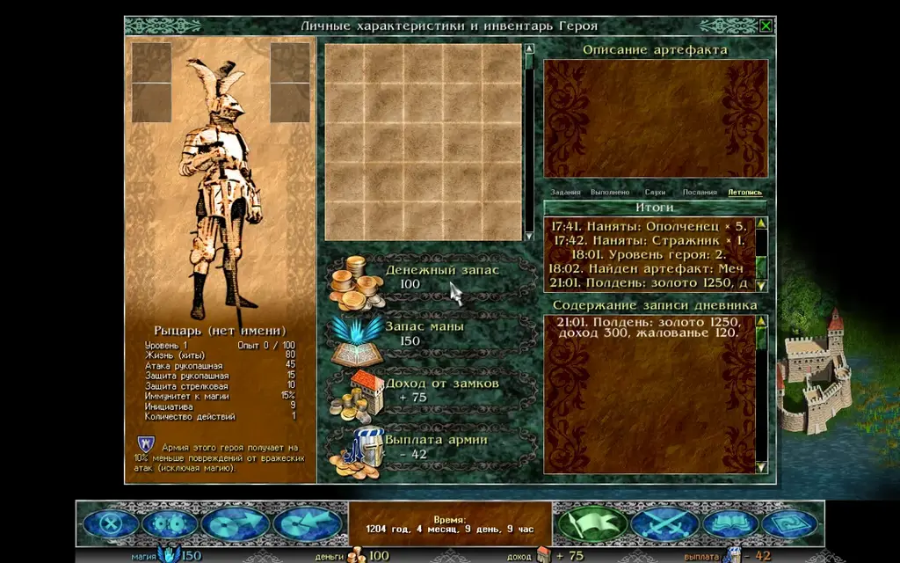
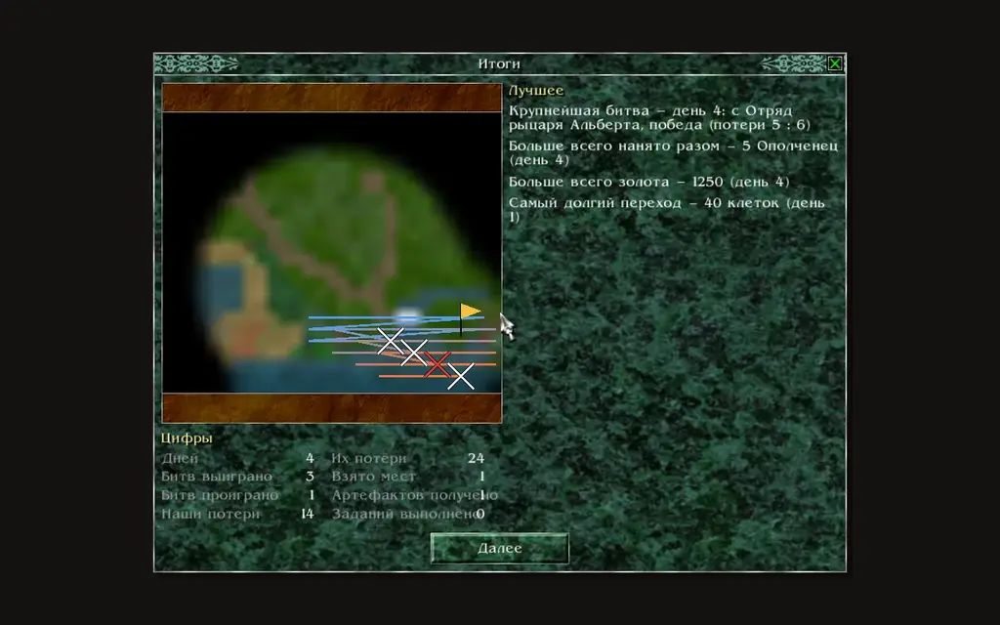

Razdor записывает ход игры в **Летопись** и показывает страницу **«Итоги»**. В оригинале этого нет: дневник героя показывает только задания и записи, а после карты сразу идёт следующий экран.

## Летопись

Летопись — пятая вкладка дневника героя. Дневник открывается флагом на нижней панели или клавишей `J`; вкладка называется **«Летопись»**.

В ней записи идут по дням, новые сверху, с заголовком «День N». Каждая запись — короткая строка о событии:

* окно события с текстом, которое показала игра;
* битва: победа или поражение и потери с обеих сторон;
* взятое место и вход в город или замок;
* найм и отпуск воинов, воины, павшие вне боя;
* уровень героя, выученное заклинание, найденный или купленный артефакт;
* задание взято или выполнено;
* полуденный отчёт: золото, доход и жалованье.

Что происходит под туманом войны, и битвы между армиями ИИ не записываются: Летопись только о том, что видел и делал игрок.

Летопись хранится в сохранении, поэтому после загрузки она та же. В старых сохранениях ранние дни не записаны, и вкладка об этом пишет.

Вкладка «Летопись»: записи по дням. Кнопка «Итоги» вверху списка показывает всю историю до текущего момента.

## Итоги

Страница **«Итоги»** подводит итог карты. Она открывается, когда карта заканчивается: после окна победы, поражения или гибели героя, до следующего экрана. Её можно открыть и в любой момент из Летописи (кнопка «Итоги» вверху списка); тогда в итогах вся история до этого дня.

На странице:

* **карта**, какой её открыл герой: только известная ему земля, обрезанная по краю исследованного;
* **путь героя** на ней: в начале он холодного цвета, к концу тёплого;
* битвы и захваты отмечены там, где они произошли;
* **«Лучшее»**: самая крупная битва, больше всего нанято разом, больше всего золота, самый долгий переход;
* **«Цифры»**: дней, битв выиграно и проиграно, потери своих и чужих, взято мест, заданий выполнено, артефактов получено.

Страница «Итоги»: путь героя по известной земле, битвы на карте и цифры.

:::note
Страница «Итоги» — дополнение Razdor, как и Летопись. Правила карты от неё не меняются.
:::

## Настройка

Строка **«Итоги после карты»** на вкладке **«Прочее»** окна настроек выключает показ страницы после карты (по умолчанию включён). Летопись при этом остаётся: её можно открыть из дневника в любой момент.
