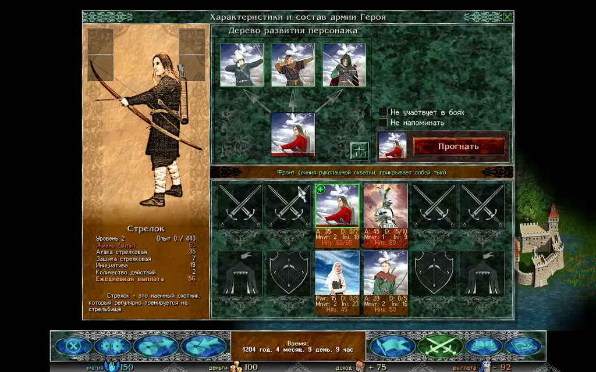
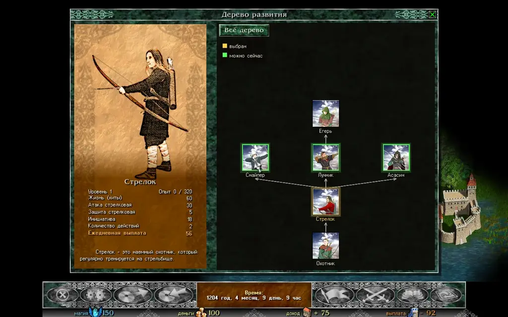
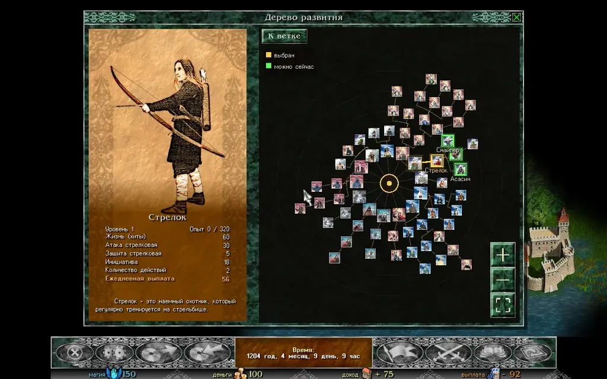

Razdor добавляет в армию окно **«Дерево развития»**. Оно показывает всю ветку развития выбранного воина, а кнопка **«Всё дерево»** — всё дерево мода. В оригинале в панели армии видны только ближайшие шаги.

:::note
Окно «Дерево развития» — дополнение Razdor, как и Летопись. Правила развития от него не меняются.
:::

## Как открыть

1. Откройте окно армии «Характеристики и состав армии Героя».
2. Выберите воина: нажмите его карточку в составе армии.
3. Нажмите маленькую кнопку с иконкой дерева в правом нижнем углу панели «Дерево развития персонажа».

## Ветка воина

В центре окна — выбранный воин, в золотой рамке. Его возможные повышения показаны выше него, до конечных классов. Предшественники, из которых он вышел, — маленькие карточки под ним, корень ветки внизу.

Легенда:

* золотая рамка — «выбран»;
* зелёная рамка — «можно сейчас»: воина можно повысить сейчас (уровень 2 или выше, и это не герой).

Окно никогда не повышает воина: повышение делается в панели армии. Нажмите любую карточку, и рядом с деревом появятся её характеристики.

## Ветки в больших модах

Если у класса несколько веток, их варианты показаны строками карточек. Свёрнутая ветка — это карточка с числом «+N» (сколько классов скрыто за ней). Нажмите её, чтобы открыть эту ветку. Так выглядят ранние классы большого мода, например «Нищий» из Evolution.

## Всё дерево

Кнопка **«Всё дерево»** показывает всё дерево мода кругом. Путь выбранного воина выделен золотом, его следующие шаги — зелёным.

* Масштаб: колесо мыши, щипок на телефоне или кнопки **+** и **−**; кнопка с четырьмя углами возвращает размер «по окну».
* Перемещение: тяните мышью или пальцем.
* Нажатие на воина в круге открывает его ветку.
* Кнопка **«К ветке»** возвращает к ветке выбранного воина.

## Другие моды

Окно читает данные воинов из установленной игры или мода, поэтому дерево любого мода показывается так, как его задал мод.

Закрыть окно можно крестиком в правом верхнем углу или клавишей Esc.
