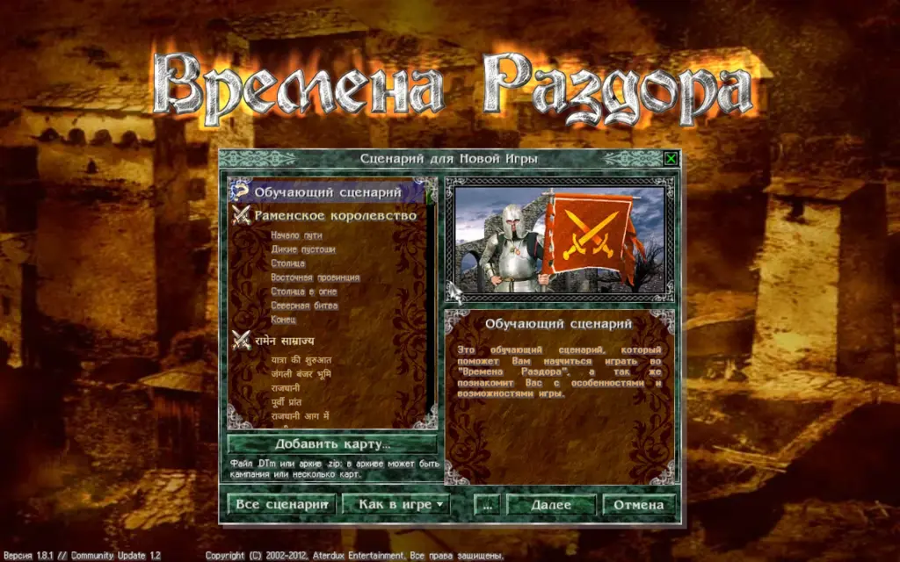

На экране сценария рядом с кнопкой «Далее» есть кнопка «...». Она открывает пятнадцать независимых переключателей, которые меняют правила игры. Первые восемь Razdor добавляет, в оригинале их нет. Последние шесть («Благословение раз в ход», «Яд не действует на нежить», «Без предела книги заклинаний», «Скидка торговца от предмета», «Интендантство всегда −30%», «Склад в своих зданиях») отвечают за правила, в которых Razdor отличался от оригинала: по умолчанию игра ведёт себя так же, как оригинал, а переключатель включает прежнее правило Razdor.

:::caution
По умолчанию для новой игры все пятнадцать выключены. Выбор запоминается: он сохраняется в настройках при закрытии окна («ОК», Esc, Enter или кнопка закрытия) и при старте игры, поэтому при следующем открытии списка новых игр переключатели будут такими, какими вы их оставили, а также после перезапуска игры. В списке сценариев оранжевая метка «Экспериментальные правила включены» показывает, что какой-то переключатель включён. Возврат из окна выбора героя его сохраняет. Для уже начатой игры переключатели через это меню не меняются.
:::

## Переключатели

* **Все особые бонусы одновременно:** боец сохраняет способности своего типа и способности надетых предметов. Одинаковые способности не складываются: повторная копия не усиливает эффект.
* **Шесть ячеек снаряжения:** у бойца шесть ячеек для предметов вместо четырёх (добавляется третья пара).
* **Без ограничений на предметы:** любой предмет можно надеть на любого живого бойца, пока у него есть свободная ячейка. Снимаются ограничения по классу (щит, оружие ближнего и дальнего боя, посох), по школе магии и священным предметам, правило «одно оружие», правило «один предмет каждого рода» и ограничение короны (только герой и знатные воины). Корону можно надеть на любого бойца. Зелья и прочие вещи по-прежнему не надеваются, мёртвые ничего не надевают.
* **Не более двух зелий на персонажа:** между битвами армии можно выпить не больше двух зелий (лечебных и воскрешающих тоже).
* **Бесплатные юниты:** бойцы армии героя не просят ежедневной выплаты (ни золотом, ни маной). Найм стоит как обычно.
* **Автоматическая прокачка:** как только бойцу армии героя открыто повышение в классе, он повышается сам, по случайной ветке древа развития. Герой так не повышается.
* **Юниты не умирают:** погибшие в бою бойцы армии героя после боя возвращаются с 1 здоровья, если армия пережила бой.
* **Ускоренный ИИ:** армии думают быстрее на больших картах (от 300×300 клеток): на таких картах они ищут путь только в квадрате 64 клетки вокруг себя, а армия с одной целью идёт к ней кратчайшим путём. Ходят чуть иначе, чем в оригинале.
* **Благословение раз в ход:** боец получает благословение не больше одного раза за ход, а благословенного союзника лечат, только если лечение что-то даёт. Выключено (как в оригинале): благословение можно повторять, и его эффекты складываются.
* **Яд не действует на нежить:** нежить не отравляется ни одним ядом. Выключено (как в оригинале): яд действует на любого бойца.
* **Без предела книги заклинаний:** читать можно любое заклинание из книги. Выключено (как в оригинале): читаются только первые 15 заклинаний книги, а заклинание, полученное из события после пятнадцатого, известно, но не читается. В святилище книгу из ровно 15 заклинаний нельзя пополнить (в оригинале это ошибка, она сохранена).
* **Скидка торговца от предмета:** скидку торговца дают и предмет с этим свойством в рюкзаке героя. Выключено (как в оригинале): только бойцы армии с этим свойством.
* **Интендантство всегда −30%:** интендантство всегда снижает жалованье на 30%. Выключено (как в оригинале): когда у игрока нет дохода от городов, снижение больше, примерно на 70%.
* **Склад в своих зданиях:** в своём замке, форте или городе, где стоит герой, появляется вкладка «Склад» с добычей, которую воины гарнизона не смогли надеть; щелчок кладёт предмет в рюкзак героя. Выключено (как в оригинале): вкладки нет, добыча остаётся в здании.
* **Проклятие смерти при контрударе:** если контрударом или упреждающим ударом убит боец с проклятием смерти (или призрак с условным проклятием, как при обычном убийстве), то воин, который ударил в ответ, тоже погибает, а его оставшиеся очки здоровья засчитываются его стороне как потери. Выключено (как в оригинале): контрудар не действует как обычное убийство, и тот, кто ударил, выживает.

Строка «Правила Раздора» над переключателями включает сразу все прежние правила Razdor (перечисленные выше) и его исправления, в том числе «Проклятие смерти при контрударе», и не трогает остальные переключатели. Строка включена, когда все они включены; нажмите её ещё раз, чтобы выключить их все. После этого каждый переключатель можно включить или выключить отдельно.

На телефоне, если окно не помещается, список переключателей прокручивается.

:::tip
Правила о предметах и зельях действуют на все армии: ваши войска, противников и гарнизоны. «Бесплатные юниты», «Автоматическая прокачка» и «Юниты не умирают» — только на армию героя.
:::

## Участие воинов в битвах

В группе «Бой и армия…» окна настроек есть параметр **«Отключение бойцов»**, выключенный по умолчанию.

Когда он включён, выберите живого не-героя в окне армии и отметьте флажок **«Не участвует в боях»** над строкой «Не напоминать» (в окне армии, справа вверху). После отметки или снятия флажка выделение с бойца снимается. Чтобы вернуть воина в бой, снимите флажок.

* Отмеченный воин остаётся в отряде, занимает свою клетку в строю и получает жалованье.
* Он не участвует в бою, не получает опыт и не входит в число участников битвы.
* Героя исключить нельзя.

## Расстановка и обход армий

В группах настроек есть два дополнительных параметра Razdor:

* **«Сохранять расстановку»** (включено по умолчанию): после битвы все воины, включая погибших, возвращаются на клетки, которые занимали до боя. Выключено — воины остаются на клетках, где закончили бой, как в оригинале.

## Быстрые действия с Shift

* **Перенос воина:** `Shift` и щелчок по карточке гарнизона или отряда переносит воина в свободное место другого строя.
* **Надеть предмет:** `Shift` и щелчок по предмету в рюкзаке надевает его на героя (или выпивает зелье).
* **Снять предмет:** `Shift` и щелчок по надетому предмету возвращает его в рюкзак.

## «Максимум» бережёт магов

В группе «Бой и армия…» окна настроек есть параметр **«Бережёт магов»**, включённый по умолчанию. Включён, «Максимум» не ставит своего мага или целителя туда, где один удар противника убивает его, если есть ход без этого. Оригинальный ИИ так не делает; выключите параметр, чтобы «Максимум» играл как раньше.
