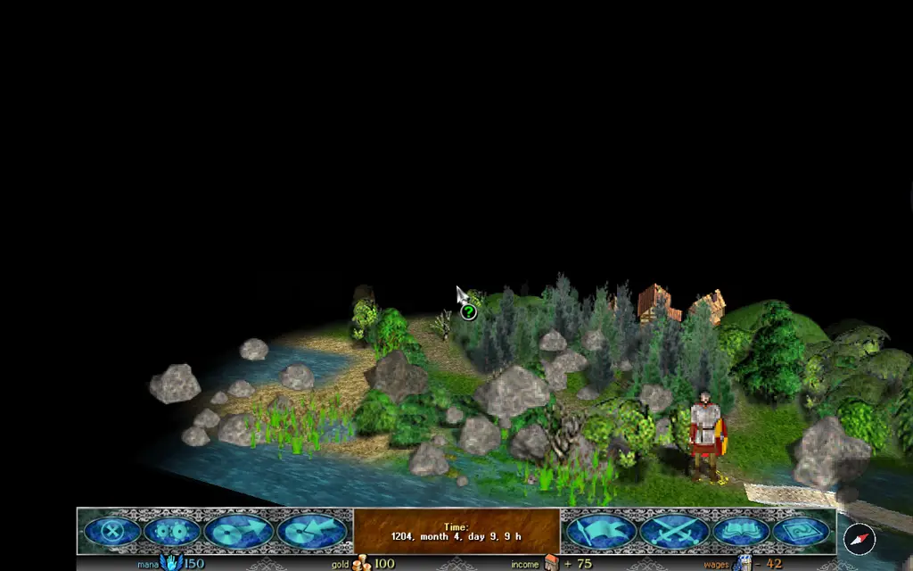

В оригинале карта бывает плоской или наклонной (2.5D). Razdor добавляет третий вид, «От первого лица»: камера стоит низко за героем или на высоте его глаз и смотрит вперёд, по его пути.

## Как включить

1. Откройте окно настроек: кнопкой на нижней панели или из главного меню.
2. Перейдите на вкладку **«Карта»**.
3. Строка **«Вид карты»** переключается по кругу: **«Плоский»**, **«2.5D»**, **«От первого лица»**.
4. Нажмите **«Принять»**.

Чтобы вернуться к наклонной карте, выберите **«2.5D»** в той же строке.

## Строки этого вида

Вместе с видом появляются две строки. У каждой есть кнопка «?» с пояснением.

* **«Даль»** — что видно у самого горизонта:
  * **«Вверх»** (по умолчанию): дальняя земля загибается кверху, как при виде сверху.
  * **«Горизонт»**: земля уходит вниз, как поверхность планеты, а над ней небо.
* **«Камера»** — где стоит камера:
  * **«За героем»** (по умолчанию): камера позади героя, он стоит ниже середины экрана.
  * **«Глазами героя»**: камера на высоте его глаз, она смотрит вперёд вдоль его пути. Сам герой и его маршрут на этом виде не рисуются.

В этом виде работают строки «Размер фигур» и «Поворот двумя пальцами», как у 2.5D.

## Управление

* **Q** и **E** поворачивают карту, как в 2.5D.
* На телефоне поворот двумя пальцами работает, если включена настройка «Поворот двумя пальцами».
* Кнопка-компас у нижней панели появляется, пока карта повёрнута, и возвращает её к северу.
* Наклон камеры (**PageUp** и **PageDown**) здесь не меняется: он есть только у 2.5D.

## Что видно на карте

* Предметы, которые стоят перед героем и закрывают его (деревья, здания, войска), на время не рисуются, пока они его перекрывают. Остальные предметы между камерой и героем остаются на месте.
* Туман войны показывается так же, как в 2.5D.

## Что не меняется

Вид только показывает карту. Правила, пути героя и бои от него не зависят. Настройка хранится в настройках игры, не в сохранении.

:::note
Дальность земли и вид камеры не влияют на ход игры: это только то, что вы видите на карте.
:::
