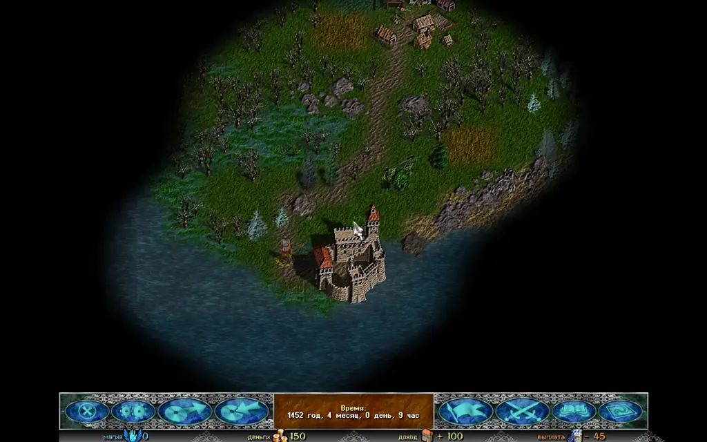
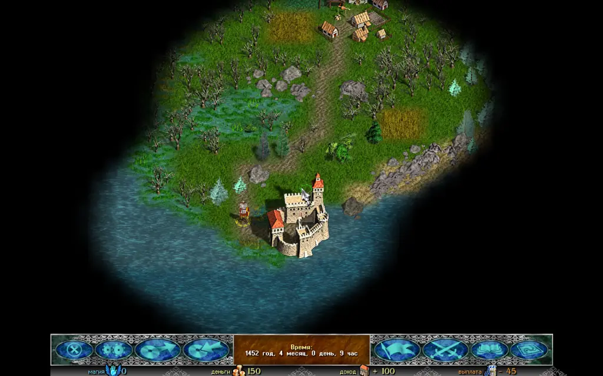
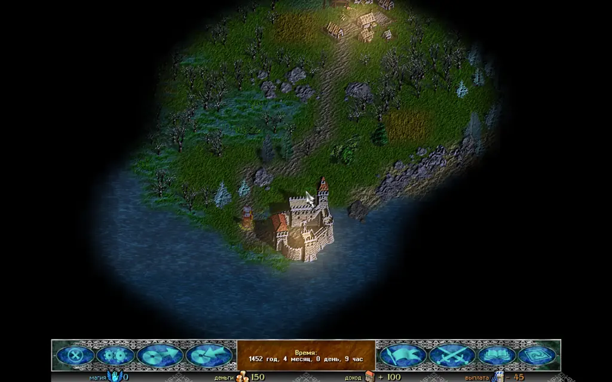
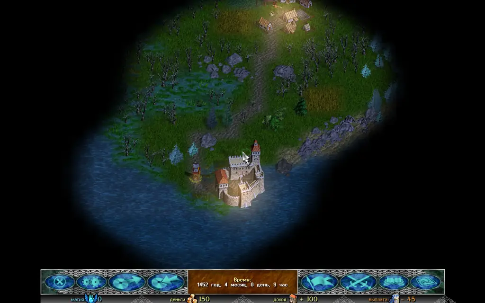
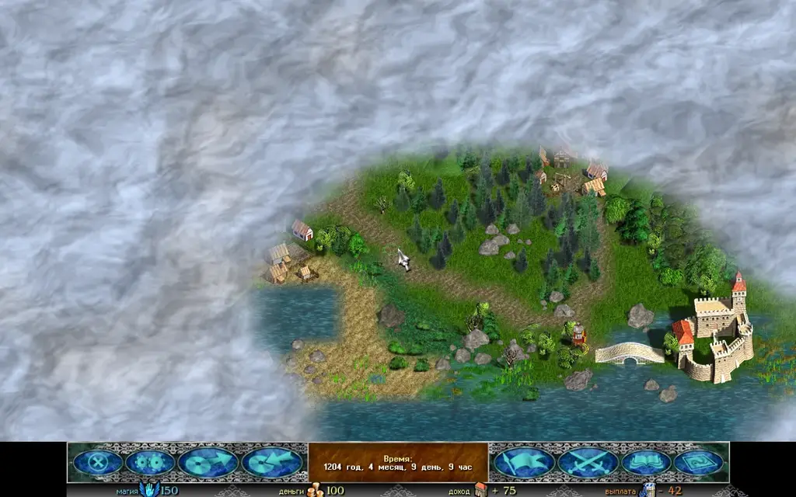
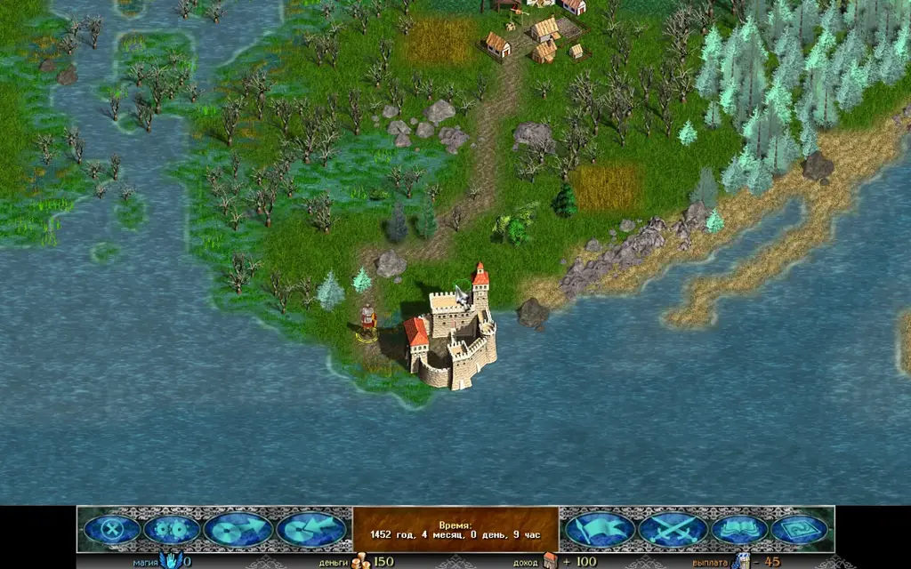
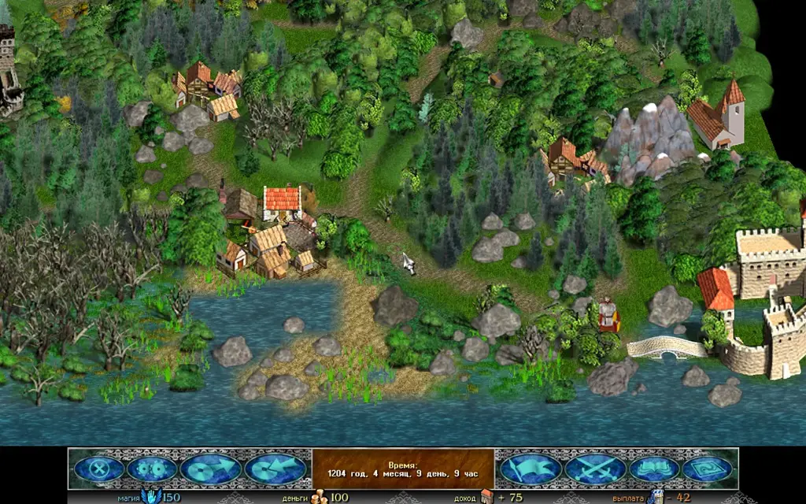
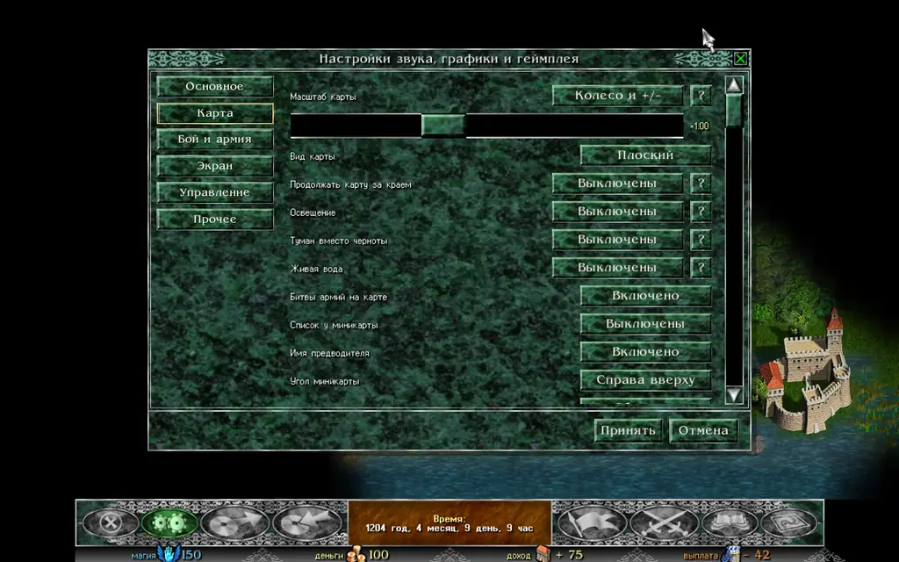

На вкладке **«Карта»** окна настроек Razdor есть три переключателя, которых нет в оригинале: **«Освещение»**, **«Туман вместо черноты»** и **«Живая вода»**. Все три выключены по умолчанию, так что новая установка выглядит как «Времена раздора».

Эти настройки меняют только вид карты. Правила, то, что игрок видит и может сделать, движение, бои, ИИ и сохранения работают так же, как в оригинале. Битвы и окна на весь экран сохраняют оригинальный вид.

:::note
Настройки относятся только к карте приключений. Бои, окна и диалоги не меняются.
:::

## Освещение

Настройка **«Освещение»** имеет четыре значения:

* **Выключено**: карта освещена, как в оригинале.
* **По часам игры**: свет следует за игровым временем. Карта плавно светлеет и темнеет, а когда игровое время стоит, свет тоже стоит.
* **Цикл в реальном времени**: одни игровые сутки длятся столько реальных минут, сколько задано в строке **«Длина суток»**: 12, 24 или 48.
* **Постоянный час**: свет не меняется; час выбирается в строке **«Час»** от 0:00 до 21:00 с шагом в 3 часа. По умолчанию стоит 18:00.

Свет проходит через рассвет, день, закат и ночь. Ночью карта синеватая, но никогда не темнее примерно 55–60 % обычной яркости, так что чёрного поля не остаётся. В городах и деревнях горят тёплые окна. У каждой армии на карте есть факел, поэтому армии видно и ночью. Огни городов и факелы появляются к вечеру и гаснут к рассвету.

Низкое солнце на рассвете и закате подчёркивает кладку, черепицу и камни на картинках, а нарисованные в картинках тени становятся глубже к вечеру и бледнеют ночью.

Рассвет, в котором карта только просыпается.

День: полный свет, без изменений относительно оригинала.

Закат: тёплый свет, огни в окнах городов и факелы армий.

Ночь: синий свет, карта по-прежнему видна.

:::tip
Чтобы увидеть смену дня и ночи без ожидания, выберите **«По часам игры»** и играйте, или **«Цикл в реальном времени»** с длиной суток 12 минут.
:::

## Туман вместо черноты

Переключатель **«Туман вместо черноты»** заменяет чёрный цвет неисследованной земли плывущим туманом. Туман скрывает ровно то, что скрывала чернота: он открывается там же, где открывалась чернота, а исследованная земля больше не затуманивается. Цвет тумана зависит от освещения: золотистый на рассвете и закате, синий ночью, серо-белый при выключенном освещении.

Туман на неисследованной части карты. Исследованная земля видна полностью.

## Живая вода

Переключатель **«Живая вода»** оживляет воду на карте:

* вода рябит;
* вдоль берегов бежит пена;
* вода отражает цвет неба: золотистый на закате, лунный ночью;
* реки текут;
* за плывущими кораблями и армиями остаётся след.

Направление течения рек угадывается по форме карты: река течёт к морю или озеру, в которое впадает. В некоторых местах река может течь не в ту сторону.

Береговая пена и рябь на воде.

## Здания в 2.5D

Это не настройка, а часть вида **2.5D** (вкладка «Карта», строка **«Вид карты»**, по умолчанию выключена). Здания в этом виде разрезаны на части: каждый дом деревни, стены и башни замка стоят на собственной земле, а не висят в воздухе одной картинкой. Их тени лежат на земле.

Так выглядят здания базовой игры и Community Update. Если у здания пока нет данных о разрезе (например, у здания из мода со своими картинками), оно стоит одним куском, как раньше.

Деревня в виде 2.5D, карта повёрнута на 45°. Поворот — клавишами Q и E.

## Как включить

1. Откройте **«Настройки звука, графики и геймплея»** и выберите вкладку **«Карта»**.
2. Найдите строки **«Освещение»**, **«Туман вместо черноты»** и **«Живая вода»**.
3. Щелчок по **«Освещению»** переключает его значения по кругу. Для **«Тумана вместо черноты»** и **«Живой воды»** значения **«Выключены»** и **«Включено»**.
4. Для режима **«Цикл в реальном времени»** под **«Освещением»** появится строка **«Длина суток»**, а для **«Постоянного часа»** — строка **«Час»**.
5. Нажмите **«Принять»**, чтобы сохранить.

Вкладка **«Карта»** с новыми строками. Все три стоят на «Выключены».

## Если карта тормозит

На слабом компьютере или на телефоне выключите все три переключателя. При выключенных настройках карта рисуется так же, как раньше.
