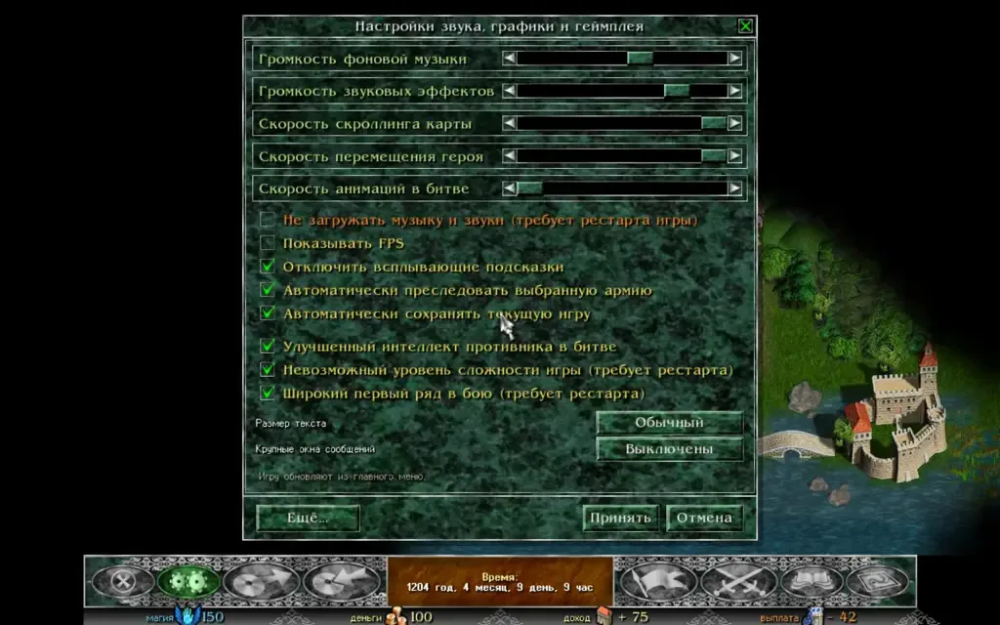

## Работа со звуком

Если в системе установлена оригинальная игра, Razdor использует её звуковые файлы и музыку. Движок считывает данные из файла `_Sounds.ini` и папки `Sounds/`. При этом файлы не копируются в папку с движком. Музыка в формате `.raw` при загрузке в память получает заголовок WAV.

:::note
Файлы `.raw` не содержат информацию о частоте дискретизации. Razdor воспроизводит их на частоте 22050 Гц. Если музыка звучит слишком медленно или низко, можно использовать переменную окружения `RAZDOR_MUSIC_RATE=44100`.
:::

### Музыкальные темы
Музыка меняется в зависимости от игрового контекста:
* **Заставка, выбор сценария и класса:** тема меню.
* **Титры:** тема титров.
* **Карта мира:** при загрузке или начале игры играет `BkgMap2`. Далее по таймеру выбирается одна из семи тем карты или тема титров. Выбор происходит на основе собственных случайных чисел игры, что может сдвигать последующие броски.
* **Бой с гарнизоном:** `BkgBattle1`.
* **Бой с армией:** `BkgBattle2`.
* **Победа:** торжественная тема звучит от момента итогов боя до закрытия окна или завершения сценария.
* **Поражение:** тема поражения звучит при гибели героя.

### Звуковые эффекты
Движок воспроизводит эффекты для множества событий: нажатие кнопок, открытие окон, боевой рог, удары магией, лечение, проклятия, покупка или использование предметов, получение золота, перемещение карт и другие действия. Звук пушечного выстрела срабатывает у стрелков, чья дальность атаки не меньше `ShotWeaponRange`.

## Настройки аудио

Управление звуком можно осуществлять несколькими способами:

1. **Клавиша N:** мгновенно включает или выключает музыку (не работает только при вводе имени сохранения).
2. **Меню Esc:** здесь доступна громкость музыки и звуков (кнопки **−** и **+**; для музыки — клавиши **+** и **−**). Для каждого типа звука можно выбрать **Выкл.** или **Вкл.**
3. **Файл конфигурации:** все настройки громкости сохраняются в `audio.json` в папке с вашими сохранениями.

:::caution
Для полной тишины можно использовать переменную `RAZDOR_NO_AUDIO=1`. Если вам нужно отследить каждое воспроизведение звука, используйте `RAZDOR_AUDIO_LOG=1`.
:::

## Системные особенности

* **Linux:** звук работает через ALSA.
* **macOS:** используется Core Audio.
* **Сборка:** если собрать движок командой `cargo build --no-default-features --features gamepad`, звук будет отключен.

Если вы запускаете Демо (без установленной игры), звука не будет.
