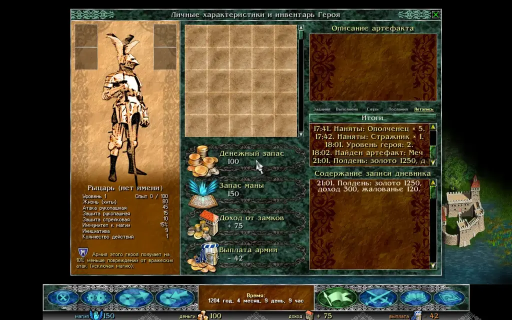
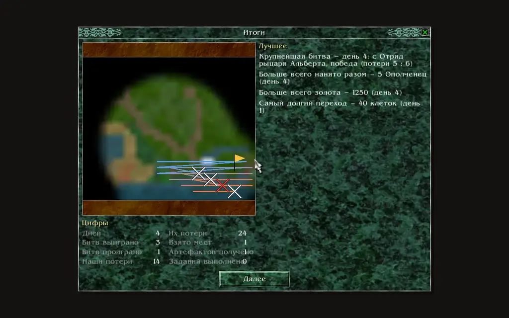

Razdor writes down the course of the game in the **Chronicle** and shows a **Summary** page. The original has neither: its hero's diary shows only quests and messages, and after a map the next screen follows straight away.

## Chronicle

The Chronicle is the fifth tab of the hero's diary. The diary opens with the flag button on the bottom bar or with the `J` key; the tab is called **"Chronicle"**.

Its entries go by day, newest first, under a heading "Day N". Each entry is a short line about one event:

* an event window with its text, as the game showed it;
* a battle: a win or a loss, and the losses on both sides;
* a place taken, and entering a town or castle;
* hiring and dismissing units, and units that fell outside battle;
* a level-up of the hero, a spell learnt, an artefact found or bought;
* a quest taken or completed;
* the noon report: gold, income and wages.

What happens under the fog of war, and battles between AI armies, are not written down: the Chronicle only covers what the player saw and did.

The Chronicle is kept in the save, so it is the same after loading. In older saves the early days are not recorded, and the tab says so.

The "Chronicle" tab: entries by day. The **"Summary"** button at the top of the list shows the whole story up to now.

## Summary

The **"Summary"** page sums up a map. It opens when a map ends: after the victory, defeat or the hero's fall window, before the next screen. You can also open it at any time from the Chronicle (the **"Summary"** button at the top of the list); then it covers the whole story up to that day.

The page shows:

* the **map**, as the hero explored it: only the land he knows, cropped to the edge of what he has seen;
* the **route** of the hero on it: cool-coloured at the start, warm at the end;
* the battles and captures, marked where they happened;
* **"Highlights"**: the biggest battle, the most hired at once, the richest moment, the longest walk;
* **"Totals"**: days, battles won and lost, our losses and theirs, places taken, quests done, artefacts got.

The Summary page: the hero's route over the known land, the battles on the map and the totals.

:::note
The Summary page is a Razdor addition, like the Chronicle. It does not change the rules of the map.
:::

## Setting

The **"Summary after a map"** row on the **"Other"** tab of the settings window turns off the page after a map (it is on by default). The Chronicle stays: you can still open it from the diary at any time.
