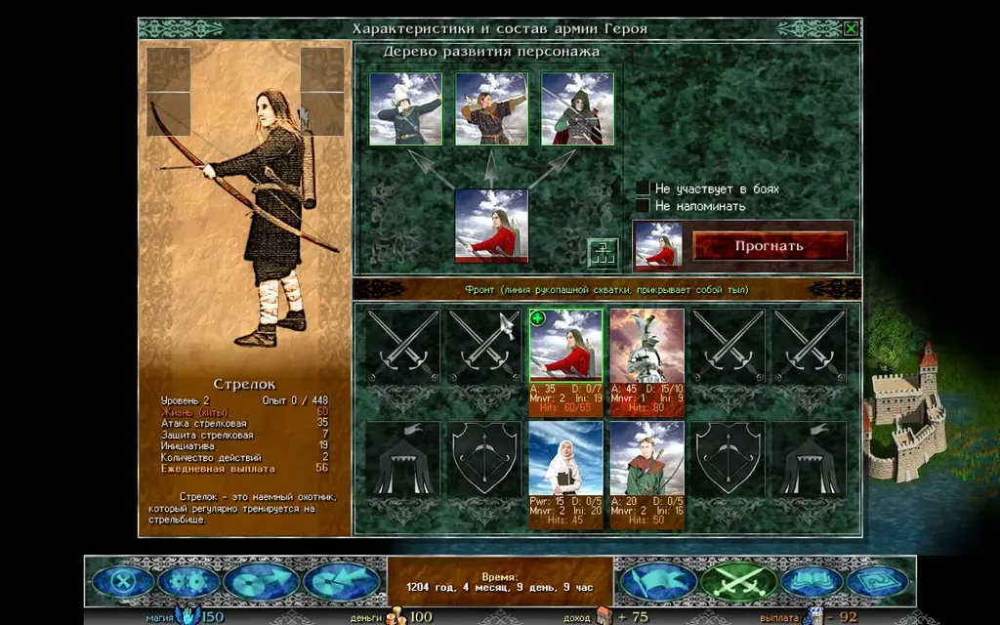
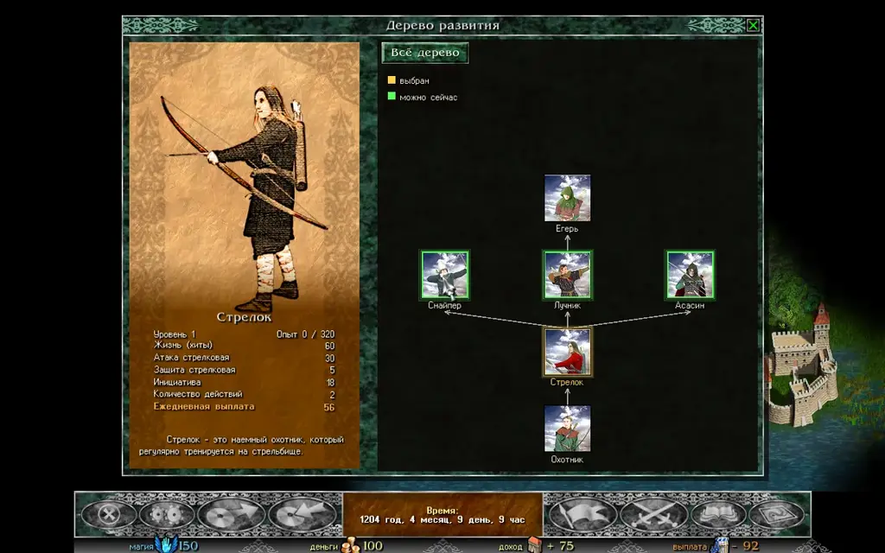
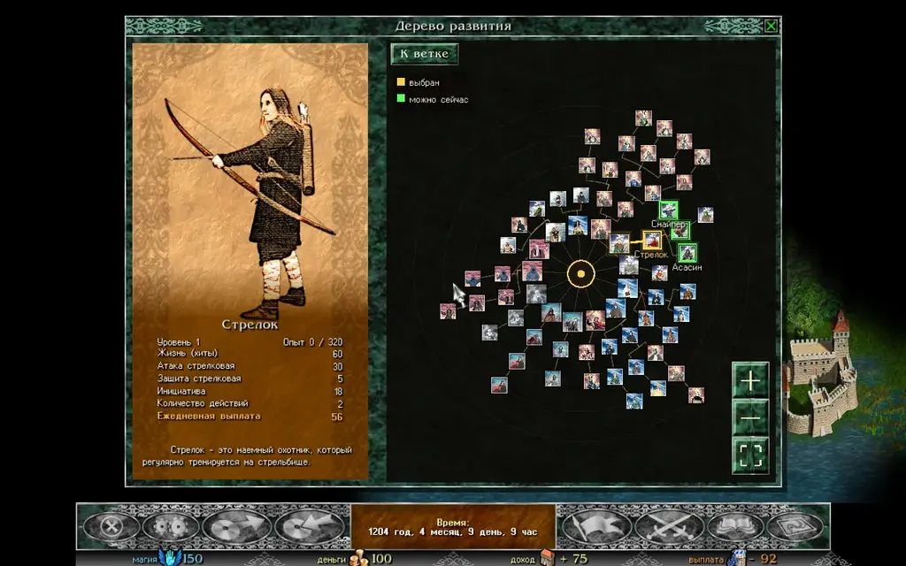

Razdor adds a **"Development tree"** window to the army screen. It shows the whole promotion branch of the selected unit, and the **"Whole tree"** button shows the whole tree of the mod. In the original, the army pane shows only the next steps.

:::note
The "Development tree" window is a Razdor addition, like the Chronicle. It does not change the development rules.
:::

## How to open it

1. Open the army window.
2. Select a unit: click its card in the army.
3. Press the small tree button in the lower-right corner of the "Development tree" pane of the character.

## The unit's branch

The selected unit stands in the middle of the window, in a gold frame. Its possible promotions are above it, up to the final classes. The classes it came from are small cards below it, with the root of the branch at the bottom.

Legend:

* gold frame: "selected";
* green frame: "can promote now": the unit can be promoted now (level 2 or higher, and it is not the hero).

The window never promotes a unit: promotion is still done in the army pane. Click any card to see its stats next to the tree.

## Branches in big mods

When a class has several branches, its options are shown as rows of cards. A folded-away branch is a card with a "+N" (how many classes lie behind it). Click it to open that branch. Early classes of big mods look like this, for example the class «Нищий» in Evolution.

## Whole tree

The **"Whole tree"** button shows the whole tree of the mod as a circle. The path of the selected unit is gold, and its next steps are green.

* Zoom: the mouse wheel, a pinch on a phone, or the **+** and **−** buttons; the button with four corners returns to the fitting size.
* Move: drag with the mouse or a finger.
* Click a unit in the circle to open its branch.
* The **"Back to the line"** button returns to the unit's branch.

## Other mods

The window reads the unit data of the installed game or mod, so any mod's tree is shown as the mod defines it.

Close the window with the X in its top-right corner, or with the Esc key.
