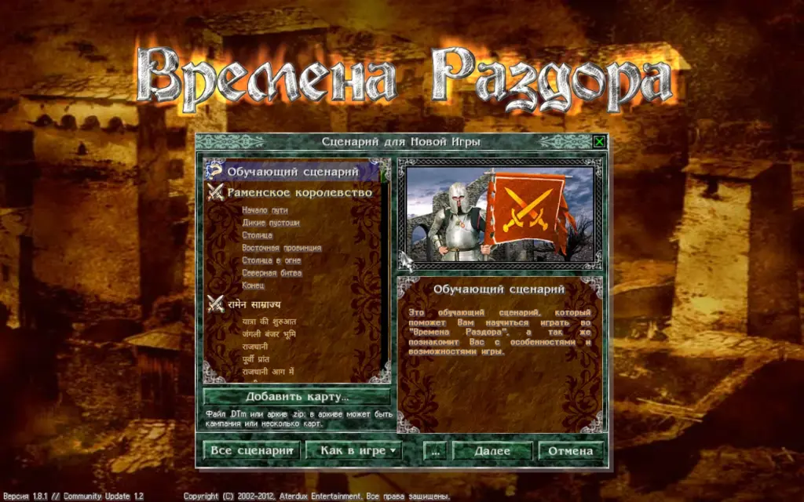

On the scenario screen, next to the "Next" button, there is a "..." button. It opens eight independent toggles that change the game rules. Razdor added these; they are not in the original game.

:::caution
By default, for a new game, all eight are turned off. Your selection is remembered: it is saved in the settings when closing the window ("OK", Esc, Enter, or the close button) and upon starting a game, so when you next open the list of new games, the toggles will be as you left them, and will remain so after restarting the game. In the scenario list, an orange "Experimental rules enabled" label indicates that a toggle is on. Returning from the hero selection window preserves it. For an already started game, toggles cannot be changed through this menu.
:::

## Toggles

* **All special bonuses simultaneously:** the fighter retains their type abilities and the abilities of equipped items. Identical abilities do not stack: a duplicate copy does not enhance the effect.
* **Six equipment slots:** the fighter has six item slots instead of four (a third pair is added).
* **No item limits:** any wearable item can be worn by any living fighter while they have a free slot. The class (shield, melee and ranged weapon, staff), magic school and holy item restrictions are lifted, as are the one-weapon rule, the one-item-per-kind rule and the crown restriction (only the hero and noble warriors). Anyone can wear the crown. Potions and other goods still cannot be worn, and the dead wear nothing.
* **No more than two potions per character:** between army battles, you can drink no more than two potions (including healing and resurrection potions).
* **Free units:** the hero's army asks for no daily wages (neither gold nor mana). Hiring costs as usual.
* **Automatic promotion:** as soon as a fighter of the hero's army can be promoted, it is promoted on its own, along a random branch of its upgrade tree. The hero is not promoted this way.
* **Units don't die:** fighters of the hero's army killed in a battle come back with 1 hit point after it, if the army survived the battle.
* **Faster AI:** armies think faster on big maps (from 300×300 cells): there they search for a path only within a 64-cell square around themselves, and an army with a single target takes the shortest path to it. They move slightly differently from the original.

On a phone, when the window does not fit, the list of toggles scrolls.

:::tip
The item and potion rules apply to all armies: your troops, opponents, and garrisons. "Free units", "Automatic promotion" and "Units don't die" apply to the hero's army only.
:::

## Warrior Participation in Battles

In the advanced settings (the "More..." button in the settings window), there is a parameter called **"Disable fighters"**, which is off by default.

When it is enabled, select a living non-hero in the army window and tick the **"Does not participate in battle"** check box above the "Don't remind" line (top right of the army window). After it is ticked or unticked the warrior is deselected. To return a warrior to battle, untick it.

* The marked warrior remains in the squad, occupies their cell in the formation, and receives wages.
* They do not participate in battle, do not gain experience, and are not counted among the battle participants.
* A hero cannot be excluded.

## Army Deployment and Pathfinding

In the "More..." menu, there are two additional Razdor parameters:

* **"Preserve formation"** (on by default): after a battle, all warriors, including those who perished, return to the cells they occupied before the battle. If off — warriors remain in the cells where they ended the battle, as in the original.

## Quick Actions with Shift

* **Moving a warrior:** `Shift` + click on a garrison or squad card moves the warrior to an empty slot in another formation.
* **Equip item:** `Shift` + click on an item in the backpack equips it to the hero (or drinks a potion).
* **Unequip item:** `Shift` + click on an equipped item returns it to the backpack.

## "Maximum" Protects Mages

In the advanced settings ("More..."), there is a parameter called **"Protects mages"**, which is on by default. When enabled, "Maximum" will not place their mage or healer where a single enemy strike would kill them, if a move exists that avoids this. The original AI does not do this; disable the parameter to make "Maximum" play as before.
