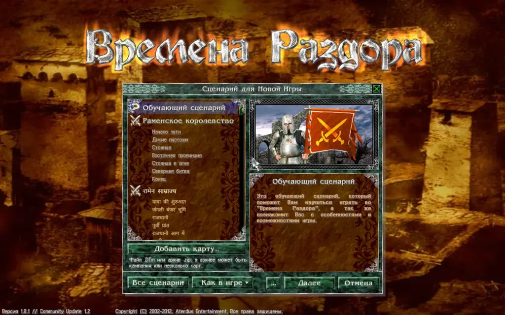

On the scenario screen, beside the "Next" button, there is a "..." button. It opens six independent switches that change the game's rules. Razdor adds them; the original has none of them.

:::caution
By default, for a new game everything is off except the duplicate-item restriction (the "Allow duplicate items" switch is off). The choices reset when a new game is started from the main menu. Returning from hero selection keeps them. For a game already under way, these switches cannot be changed from this menu.
:::

## The switches

* **All special bonuses simultaneously:** a unit keeps the abilities of its type and the abilities of the items it wears. Identical abilities do not stack: a repeated copy does not strengthen the effect.
* **Six equipment cells:** a unit has six item cells instead of four (a third pair is added).
* **Allow multiple rings** and **Allow multiple amulets:** these items may occupy any equipment cells. Restrictions by class, magic school, holy items and weapon type still apply.
* **Allow duplicate items:** off — one unit cannot wear two identical items. On — several copies of one item are allowed, but a unit still has only one weapon.
* **At most two potions per character:** between battles, an army can drink no more than two potions (healing and revival potions included).

:::tip
The rules apply to all armies: your troops, the opponents and the garrisons.
:::

## Unit battle participation

In the advanced settings (the "Advanced…" button in the settings window) there is **"Unit battle participation"**, off by default.

When it is on, select a living non-hero in the army window and press **"Exclude from battles"** beside the dismiss button. To return a unit to battle, press **"Return to battle"**.

* A marked unit stays in the squad, keeps its place in the formation and still gets its wages.
* It does not fight, gets no experience, and is not counted among the battle's participants.
* The hero cannot be marked.

## Formation and routing around armies

Two extra Razdor settings are in "Advanced…":

* **"Keep formation after battle"** (on by default): after a battle every unit, including the dead, returns to the cells it held before the fight. When off, units stay in the cells where the battle ended, as in the original.
* **"Route around armies"** (off by default): when off, the hero walks through the cells of other armies, and a meeting starts a battle, as in the original. When on, the route is searched around armies. If no way around exists, the hero takes the shortest route up to the first army on the way.

## Shift shortcuts

* **Move a unit:** `Shift` and a click on a garrison or squad card moves the unit to a free place in the other formation.
* **Equip an item:** `Shift` and a click on an item in the backpack equips it on the hero (or drinks it, for a potion).
* **Take off an item:** `Shift` and a click on a worn item returns it to the backpack.
