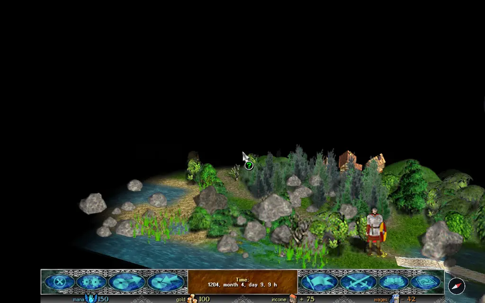

The original's map is flat or tilted (2.5D). Razdor adds two views the original does not have:

* **"Third person"**: the camera stands behind the hero and looks forward along his path;
* **"First person"**: the camera stands low, at the height of the hero's eyes, and looks forward along his path.

## How to turn it on

1. Open the settings window: with the button on the bottom bar, or from the main menu.
2. Go to the **"Map"** tab.
3. The **"Map view"** row cycles through **"Flat"**, **"2.5D"**, **"Third person"** and **"First person"**.
4. Click **"Apply"**.

To go back to the plain map, choose **"Flat"** in the same row.

## The rows of these views

These views add their own rows to the "Map" tab. Each has a "?" button with an explanation.

* **"Far ground"**: what is seen at the horizon:
  * **"Up"** (the default): the far ground curves up, as in a top-down view.
  * **"Horizon"**: the ground falls away, like the surface of a planet, with the sky above it.
  * **"Globe"**: the ground curves away on every side, like a small planet, and the horizon becomes a circle.
* **"Curve start"**: how much ground in front of the hero stays flat before it starts to bend.
* **"Curve strength"**: how steeply the ground bends up, down or around (in "Globe").
* **"Camera height"**: in third person, how far and high the camera stands behind the hero (100% is as before); in first person, the eyes' height above the ground (0.70 is as before).
* **"Camera tilt"**: the angle the camera looks down at: in third person from 5° to 60°, in first person from −5° (up) to 30°.
* **"Field of view"**: how much is seen across the frame's height, from 35° to 90°. Wider shows more ground, and the edges bend more.
* **"Curve and camera"**: puts these rows of the current view back to their earlier values. Each view has its own values.
* **"Camera follows the hero"** (third person only): the camera turns by itself to where the hero walks. Your own turn (Q, E or the compass) stops it until the hero's next move. Off by default.

The **"Sprite size"** and **"Two-finger turn"** rows work in these views, as they do in 2.5D.

## Controls

* **Q** and **E** turn the map, as in 2.5D.
* On a phone, the two-finger turn works when the "Two-finger turn" setting is on.
* The compass button by the bottom bar appears while the map is turned, and turns it back to north.
* **PageUp** and **PageDown** do not change the tilt here: in these views the "Camera tilt" row sets it. They still tilt the 2.5D view, as before.

## What you see on the map

* Objects that stand in front of the hero and cover him (trees, buildings, armies) are not drawn while they cover him. Other objects between the camera and the hero stay where they are.
* The fog of war is shown the same way as in 2.5D.
* The minimap shows which part of the map the camera sees, and where the hero looks (see [Interface](/razdor/wiki/en/tutorials/interface/)).

## What does not change

The view only shows the map. The rules, the hero's routes and battles do not depend on it. The settings are kept in the game's settings, not in the save.

:::note
The far ground and the camera do not affect the game itself: they only change what you see on the map.
:::
