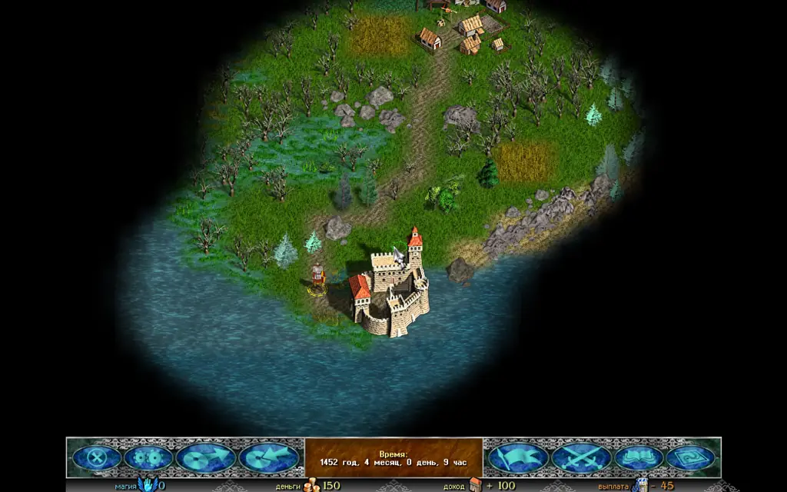
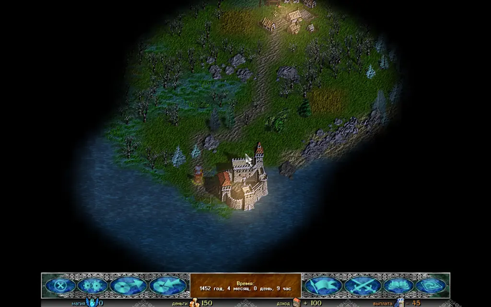
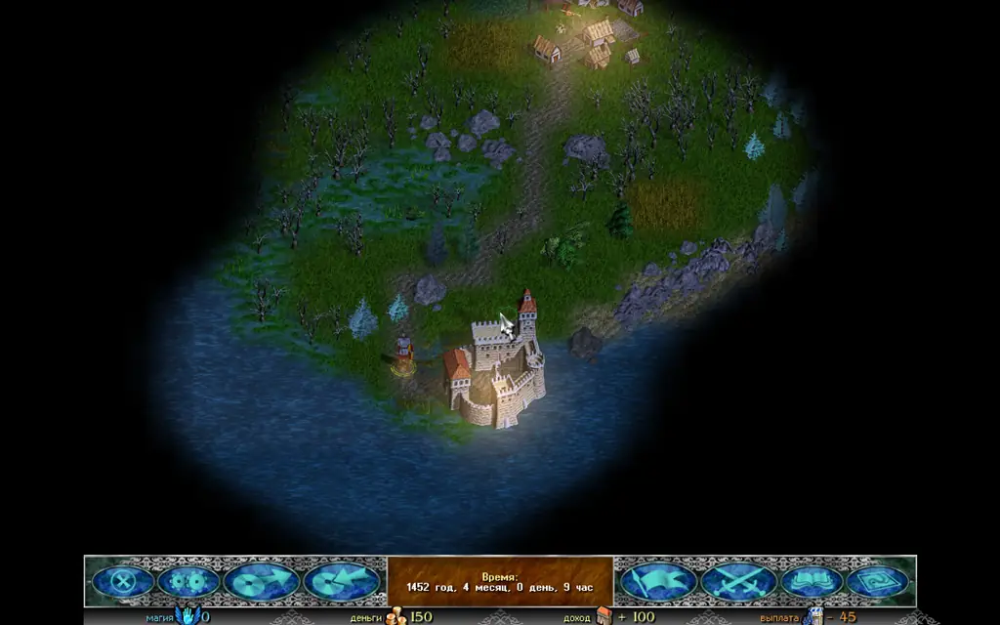
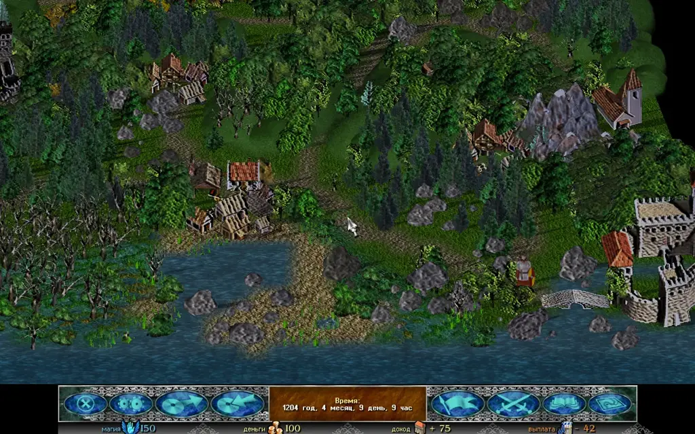
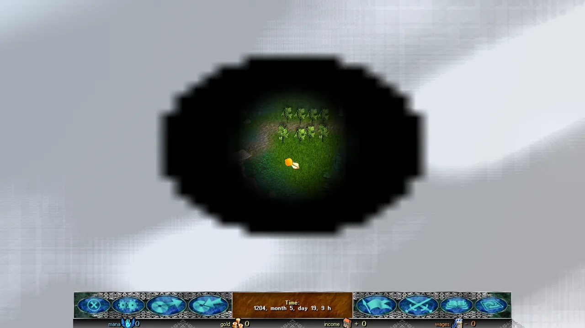
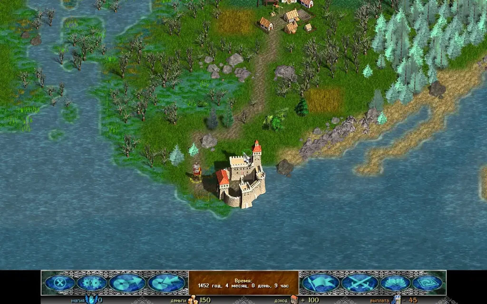
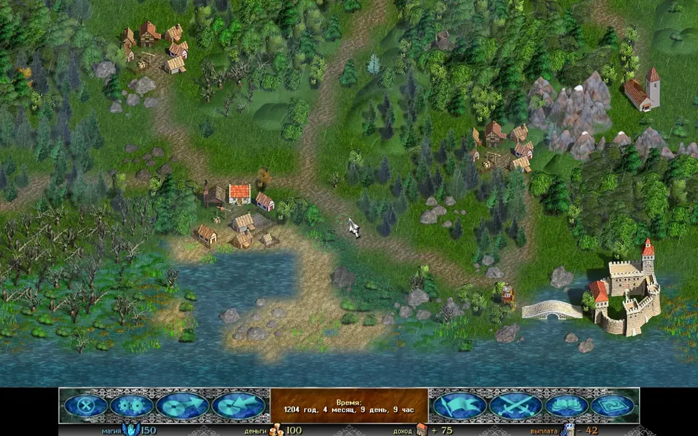
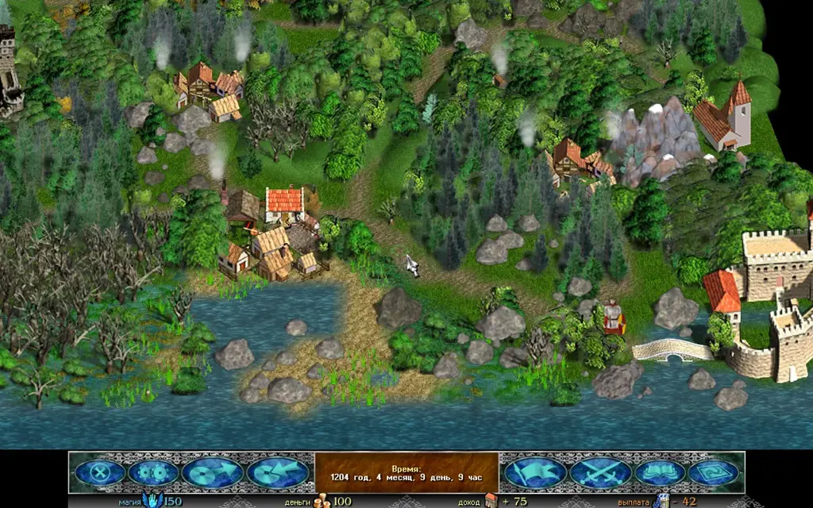
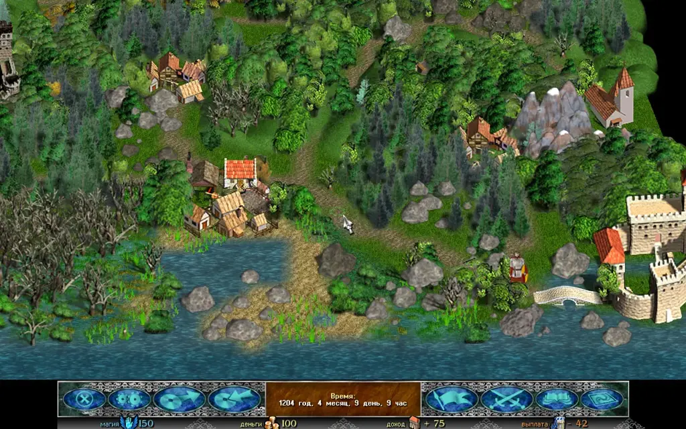
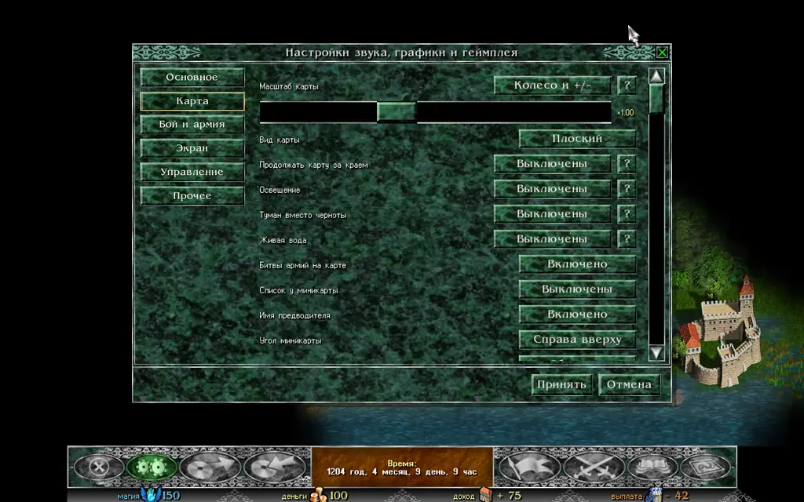

The **Map** tab of the settings window has new rows that the original does not have: **Lighting**, **Mist instead of black**, **Moving water**, **Weather** and **Living map**. All of them are off by default, so a new install looks like Discord Times.

These settings change only how the adventure map looks. The rules, what the player can see and do, movement, battles, the AI and saves work as in the original. Battles and full-screen windows keep the original look.

:::note
The settings apply to the adventure map. Battles, windows and dialogues do not change.
:::

## Lighting

The **Lighting** row chooses how the light on the map changes:

* **"Off"**: the map is lit as in the original.
* **"Game clock"**: the light follows the game time. The map brightens and darkens smoothly, and when the game time stops, the light stops too.
* **"Real-time cycle"**: the days pass on their own. The **"Day length"** row sets how many real minutes one game day lasts: 12, 24 or 48. The default is 24.
* **"Fixed hour"**: the light does not change. The **"Hour"** row sets the hour, from 0:00 to 21:00 in steps of three hours. The default is 18:00.

The light goes through morning, day, evening and night. At night the map is bluish and dimmed, but not black. In the morning and at sunset the light is warm: the low sun brings out the masonry, the roof tiles and the stones, and their shadows lie long.

At night buildings glow from within: the windows of towns, castles and villages burn with warm light. The hero and the armies carry torches, so they can be seen in the dark, and the lights cast shadows.

When a window is open over the map, the map behind its edge keeps showing the light of its hour.

Day: full light, as in the original.

Evening, 18:00: warm light, the lit windows and the armies' torches.

Night: blue light, and the map is still easy to see.

### Shadows and light quality

These two rows appear when **"Lighting"** is on.

* **"Shadows"**: **"Painted"** (the default) keeps the original's shadows. **"From the sun"** removes them, and every building, tree and rock casts its own shadow: it turns and lengthens, changing once per game hour.
* **"Light quality"**: **"High"**, **"Medium"** or **"Low"**. High lights up to eight buildings and the figures' torches: their shadows and the glowing windows. Medium does up to four. Low keeps just the warm glow. The default is High on a computer and Medium on a phone.

"From the sun" shadows in 2.5D: each building casts its own shadow on the ground.

:::tip
To see the day and night change without waiting, choose **"Game clock"** and play, or **"Real-time cycle"** with a day length of 12 minutes.
:::

## Mist instead of black

The **"Mist instead of black"** setting replaces the black of unexplored land and has three looks:

- **"No"**: the war fog's black, as in the original (the default).
- **"Simple"**: an even haze of the same colour with a soft edge. The lightest look, for a phone.
- **"Clouds"**: soft clouds drift over the unexplored land; the edge of the explored land runs straight into them.

The mist hides exactly what the black hid: it opens where the black opened, and explored land stays fully visible.

The mist opens gradually: when the hero walks, and when an event shows a place, the land comes out of the mist little by little, from the centre.

In every view of the map the mist lies on the ground itself, with no layers; there is no wall at the edge of the explored land.

Clouds over the unexplored part of the map. The explored land is fully visible.

## Moving water

The **"Moving water"** switch brings the water on the map to life:

* the water ripples;
* foam runs along the shores, and waves roll up the shores of lakes and the sea;
* the water reflects the colour of the sky: golden at sunset, moonlit at night;
* glints of sun and moon shine on lakes and the sea, brighter at sunset and at night;
* rivers flow with the current, faster through narrow places;
* ships and armies on the move leave a wake behind them;
* when the map is zoomed out, the ripples and waves calm down: far off, the water is quieter.

The direction of a river's flow is worked out from the shape of the map: a river flows toward the sea or lake it runs into. In a few places a river may flow the wrong way. Lakes and the sea stay still.

Under **"Moving water"** there are two rows that appear only with it on:

* **"Water animation rate"**: the water can be redrawn every frame, every second frame or every third frame. The motion stays smooth. Default: every frame.
* **"Water quality"**: the water can be drawn at full size, three-quarters or half the screen; the water gets softer, but runs faster. Default: high.

Foam along the shore and ripples on the water.

## Weather

The **"Weather"** switch shows weather that depends on the land under it:

* snow over snowfields and ice;
* rain over swamps and lowlands;
* heat haze over deserts;
* ash over fire lands;
* cloud shadows across the whole map.

The weather changes over time: each game day brings its own, and the land decides which one it will be. When a window is open over the map, the weather keeps falling behind its edge. It is only a look.

The weather over the map: here, the cloud shadows show.

## Living map

The **"Living map"** switch brings the buildings and the sky to life on the explored part of the map:

* smoke rises from the chimneys;
* flags wave on the castles;
* now and then flocks of birds cross the map.

The mill sails do not turn yet: the building pictures have no reliable place for them.

Chimney smoke, waving flags and birds over the map.

**Far zoom.** When the map is zoomed all the way out, the flags, the smoke and the birds do not animate: at that scale they cannot be seen anyway. Very small objects are not drawn, slightly larger ones fade in smoothly.

## Buildings in 2.5D

This is part of the **2.5D** view (the **"Map"** tab, the **"Map view"** row, off by default), not a separate row. In this view the buildings stand on the ground, not in the air. A building of several parts, such as a castle or a village, is drawn as one picture: when the map turns, the parts do not drift apart, and the far ones stand behind the near ones. A slight shift between the parts gives depth. The shadows lie on the ground.

The courtyards, yards, paved squares and fields a building sits on lie flat on the map, as in the flat view; its walls and houses stand up from them. The same holds in the "From the third person" and "From the first person" views.

The buildings of the base game and of Community Update are cut this way.

A village in 2.5D, the map turned by 45°. Turn it with Q and E.

### Buildings from mods

Buildings from mods that bring their own art can stand on their own ground too. For that, a depth model is needed: it is downloaded once, about 50 MB, and runs on your device. The model is Depth Anything V2 Small (Apache-2.0).

The **"Depth model for mods"** row appears on the **"Map"** tab only in 2.5D, and only when the install has buildings without cut data. Press **"Download (50 MB)"**. Until the model is downloaded, such buildings stand as one piece, as before.

## How to turn it on

1. Open the **"Sound, graphics and gameplay settings"** window and choose the **"Map"** tab.
2. Find the **"Lighting"**, **"Mist instead of black"**, **"Moving water"**, **"Weather"** and **"Living map"** rows. The **"Water animation rate"** and **"Water quality"** rows appear under **"Moving water"** when it is on.
3. A click on **"Lighting"** cycles through its values. For the other switches the values are **"Off"** and **"On"**.
4. For **"Real-time cycle"** the **"Day length"** row appears, and for **"Fixed hour"** the **"Hour"** row. Under **"Lighting"**, the **"Shadows"** and **"Light quality"** rows also appear.
5. Press **"Apply"** to keep the changes.

The **"Map"** tab with the new rows. All of them are set to "Off".

## If the map is slow

On a weak computer or a phone, turn off the switches you do not need: the light with its shadows (or set the quality to "Low"), the mist, the water, the weather and the living map. For a faster map there are also the **"Map resolution"** row and the **"Frame rate cap"** row on the same tab. With the settings off, the map is drawn as before.
