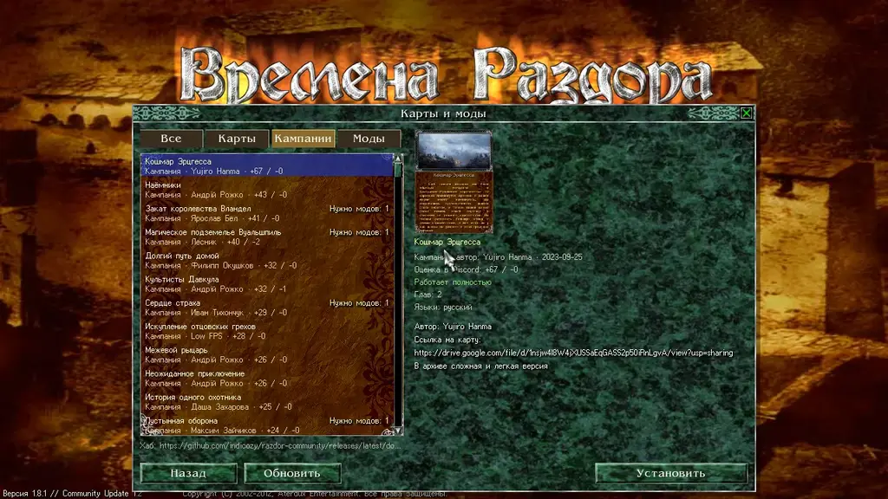

In the main menu, open the "Maps and mods" window. It holds community maps, campaigns and mods from the Discord server: 289 maps, 56 campaigns and 25 mods. Everything is installed straight from the game.

## Tabs

Entries are split into tabs:

* **All**
* **Maps**
* **Campaigns**
* **Mods**

Each entry in the list shows its kind (map, campaign or mod), its author, its rating on Discord (👍 and 👎) and its state. Entries are sorted by rating, best first. Entries without a Discord post come last, sorted by name.

## Search

A field above the list narrows it as you type: part of a title (Russian or English) or the author's name; the cross at its right or Esc empties the field.

## Opening an entry

Select an entry, and its details open on the right:

* its picture;
* author, version and date;
* its rating on Discord;
* how well it works: "Works fully", or "Works partly" with a note;
* languages;
* the description from the author's Discord post.

## Installing and removing

* **"Install"** downloads the entry together with the mods it needs.
* **"Remove"** removes the entry. A mod is not removed while an installed entry still needs it.
* **"Refresh"** reads the catalog again.

## Where the maps come from

The catalog comes from the forums of the community Discord server: the sections «сокровищница-модов» and «библиотека-карт». The entries are republished with the server admins' permission, and each one is credited to its author with a link to the author's thread.

The catalog itself is in the releases of [razdor-community](https://github.com/indicozy/razdor-community). Mods there are stored only as their difference from Community Update. Your copy of the game is never changed, and it is still needed. Music in mods is re-encoded to Ogg Vorbis to make downloads smaller.

## Playing a mod

In the new game window, pick the mod in the "Mod" list. The game then runs on that mod's data over the normal game. Maps that need a mod are listed only when that mod is chosen. Saves are kept separately for each mod.

## Partial entries

Some mods are marked "partly". They ship their own changed game program (`DiscordTimes.exe` or `ddraw.dll`), which Razdor cannot use, or they are incomplete. Such mods play, but not everything the author made may work.

Some campaigns are marked "partly" too: some of their chapters are missing from every source.

## Removing or fixing an entry

Authors who want an entry removed or fixed can write on Discord or open an issue in the [razdor-community](https://github.com/indicozy/razdor-community) repository.

:::note
The maps and mods are made by community authors; Razdor only gathers them into the catalog and checks that they load and play.
:::

:::tip
The Discord rating is the rating of the post on the server, not a Razdor rating.
:::
