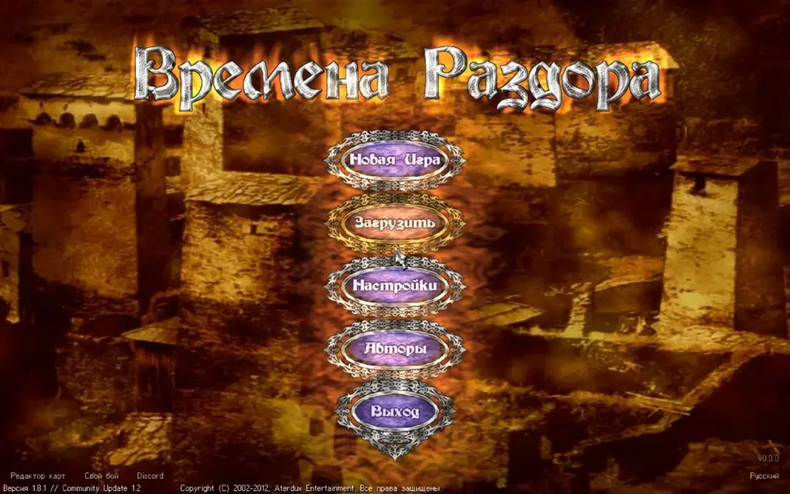

Razdor programs are published in the releases on [GitHub](https://github.com/indicozy/razdor/releases). Each system needs its own file. The game also needs your own copy of *Discord Times*: see [Game installation](/razdor/wiki/en/start/install-game/). Without it, the main menu explains that a copy of the game is needed.

## Windows

1. Download `Razdor.exe` from the release. It is a single file with no DLLs of its own.
2. Put it in a convenient folder, or next to `DiscordTimes.exe`.
3. Run it with a double-click.

:::caution
If the message "WGL_ARB_pixel_format is required" appears, the machine has no OpenGL 2 driver. This happens in a Remote Desktop (RDP) session and in virtual machines. Razdor shows its own advice on what to do.
:::

## Linux

1. Download `razdor` from the release.
2. If the system does not let you run the file, make it executable: `chmod +x razdor`.
3. Open a terminal in the folder with the file and run `./razdor`.

## macOS

1. Download `razdor-macos` from the release.
2. The program is not signed by a developer, so macOS blocks it after download. Before the first launch, run `xattr -d com.apple.quarantine razdor-macos` in Terminal, or open the program from Finder with right-click → Open.
3. A double-click opens the program in Terminal.

## Checking the download

If you want to be sure the file is not damaged, compare its SHA-256 with `SHA256SUMS` from the same release.

## Mobile devices

Installation instructions for phones are on separate pages:

- [Android](/razdor/wiki/en/phones/android/)
- [iOS](/razdor/wiki/en/phones/ios/)

After launch, if the game is found, you get to the original game's main menu.
