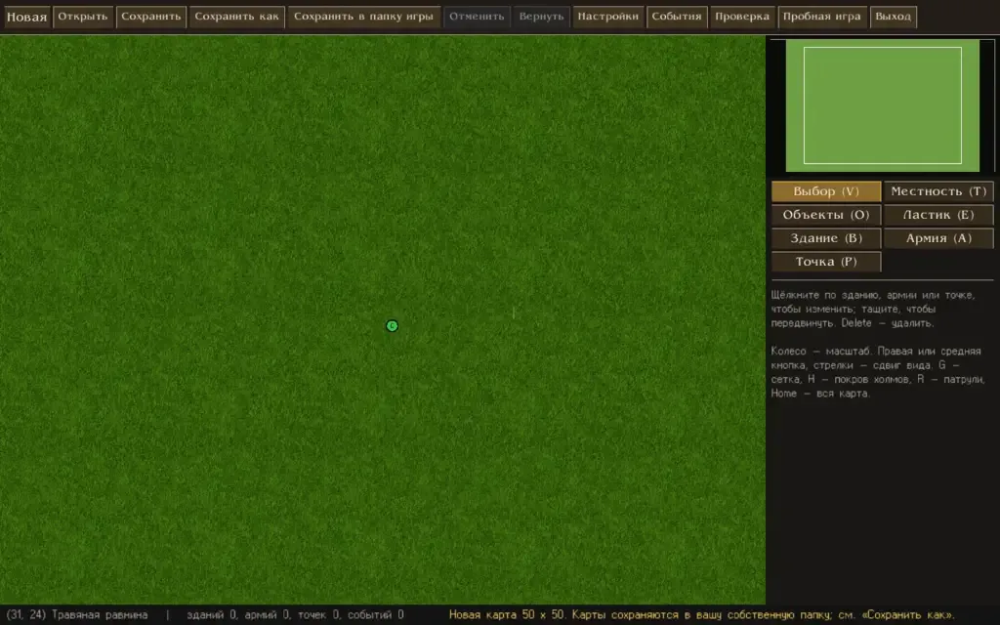

Razdor includes a built-in scenario editor that allows you to create `.DTm` format maps. These maps are compatible with both the original game and the Razdor engine.

## Launching the Editor

There are two ways to launch the editor:
1. Click the **"Map Editor"** button on the game's splash screen.
2. Use the console command: `cargo run --release -- --editor`.

:::tip
If the `RAZDOR_DT_DIR` environment variable is set on your system, the editor will use original graphics, load object and building images, and use the names of warriors, artifacts, and spells from your installed game. If the variable is not set, placeholders will be displayed instead.
:::

## Basic Tools

Editing tools are located in the right column. For convenience, you can use hotkeys:

* **"Select and Move"** (`V`): standard operation mode.
* **"Terrain"** (`T`): allows you to work with 16 types of surfaces. Brush modes (size 1/3/5/9), fill, and rectangle drawing are available.
* **"Objects"** (`O`): placement of hills, mountains, rocks, and trees. Multiple objects can be placed on a single tile.
* **"Eraser"** (`E`): removing objects.
* **"Building"** (`B`): placing buildings. The tile you click will become the bottom-right corner of the building. If the building does not fit, the preview will be red.
* **"Army"** (`A`): creating armies.
* **"Point"** (`P`): placing lanterns or event points.

## Toolbar and Controls

The top panel contains the main commands for file management and settings:

* **"New"**: create a new map (you can choose a size: 50/100/200 or set your own).
* **"Open"**: load game maps, your own maps, or specify a file path.
* **"Save"** (`Ctrl+S`) and **"Save As"** (`Ctrl+Shift+S`).
* **"Settings"**: here you can set the name, description, starting date, victory/defeat conditions, the hero's three beginnings, faction relations, campaign parameters, and named characters.
* **"Check"**: error list. If there are errors in the list, you will not be able to save the map. Clicking on an error line will take you to the problematic area.
* **"Playtest"**: launch the map in game mode. To return to the editor, press `Esc` and select "Main menu".

:::note
When editing buildings, armies, or points, you can change their properties (names, descriptions, garrisons, goods, spells, AI settings, etc.) via the panels that open. The `Delete` key removes the selected element, after which the numbers and references in the scenario are automatically recalculated.
:::

## Map Search

The search function (`Ctrl+F`) opens a window in the top right corner. It allows you to find:
* **Buildings** (by name, number, type, owner, garrison, etc.);
* **Armies** (by name, number, leader, troops, or items);
* **Points and Events** (by number, name, or message text);
* **Objects and Hero Beginnings** (by class).

To search for a specific number, use the `#` prefix (e.g., `#10`). Press `F3` to jump to the next result.

## Saving Maps

The editor automatically determines where to write the file. By default, maps are saved to your user map folder, to `RAZDOR_MAPS_DIR`, or to `~/.local/share/razdor/maps`.

* Maps opened from the game folder (`Maps_Rus`) **will never overwrite** the original game files when saved.
* The **"Save to game folder"** button allows you to write changes directly to `Maps_Rus`, but only after your confirmation. If you attempt to replace an existing shipped map, the editor will ask for confirmation a second time.
