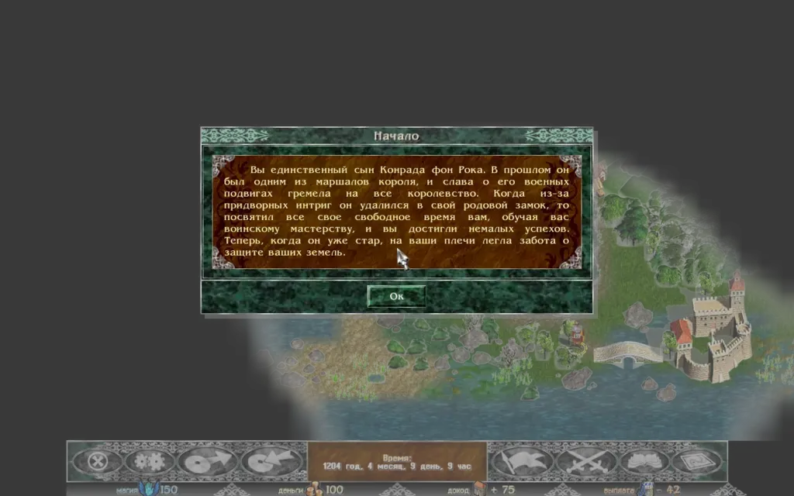
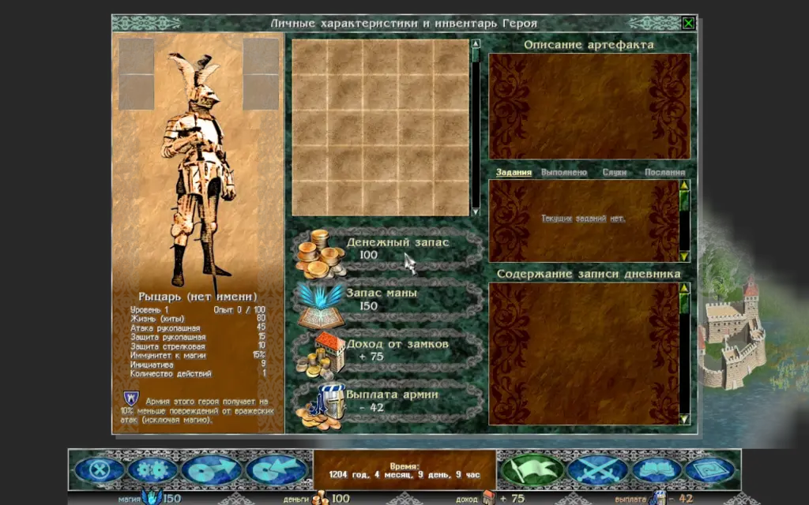
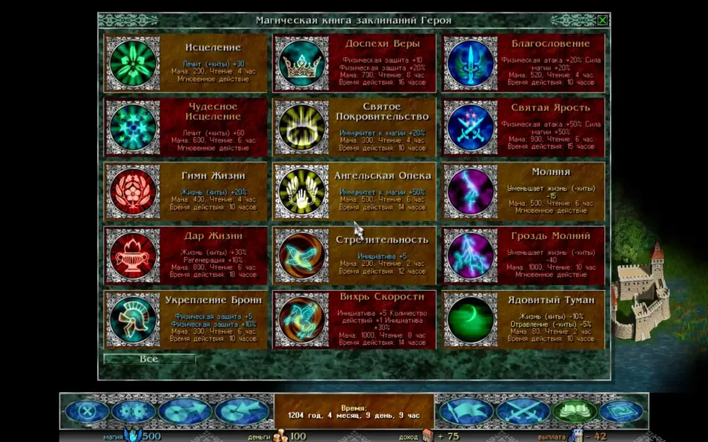

Razdor screens follow the original's layout: the map takes most of the screen, and you control the game through the bottom bar buttons and the windows.

## Bottom bar

The bar buttons are oval, as in the original, and their colour shows their state:

* **Blue** — normal buttons.
* **Grey** — while any window is open.
* **Green** — the screen of this button is open.
* **Orange** — while the minimap is shown.

From left to right: the menu (**"Main menu (Esc)"**), **"Sound settings"**, save, load. On the right: the journal (flag button, opens the hero's diary), hero and army, spell book and map. The time panel is in the middle, and below it are mana, gold, income and pay.

:::tip
To return the interface scale to "Auto", press `Ctrl+0` on any screen.
:::

## Hero window and diary

The hero and army window opens with the **"Hero and army"** button on the bar or the `A` key. The hero's diary opens with the flag on the bottom bar or the `J` key.

The diary has four tabs:

1. **"Quests"** — current quests, as in the original.
2. **"Done"**, **"Rumours"** and **"Messages"** — the Razdor history with the game date. New entries are on top, and the story messages of scripted events go to "Messages". This is a Razdor addition: the original's diary lists only the current quests.

To read an entry in full, select it.

## Spell book

The book opens with the **"The spell book"** button on the bar or the `B` key. It holds up to 15 spells. Spells are learned for gold in the Sanctuary (the "Sanctuary" tab in towns and temples).

For each spell you see:

* its cost in mana;
* the time needed to cast it;
* its duration;
* its effect.

:::caution
Casting a spell spends game time as well as mana. While the hero casts, enemy armies keep moving, and an enemy that reaches you breaks the spell.
:::

## Battle screen

A battle opens over the map. The title of the window names both armies.

* **Your formation** is at the bottom of the window, **the enemy formation** at the top.
* **Unit cards** show a portrait and a stats strip: `A` (attack), `D` (defence), `Ini` (initiative), `Mnvr` (number of actions), `Hits` (hit points), `Pwr` (power of mages).
* **A tooltip** on hover shows the action in advance, for example "Click to curse: Initiative: -5".
* **Empty cells** show swords (front row), a bow (back row) or a tent (reserve).

The card of the unit that moves is outlined in green. Cells it can step to are highlighted in blue, and its targets in red (green under the mouse) or blue.
