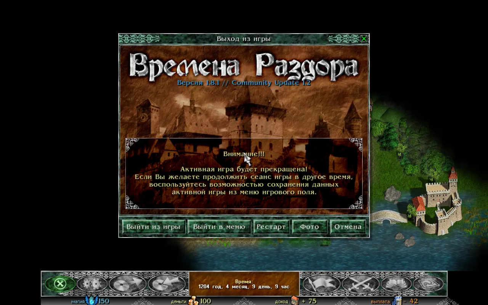
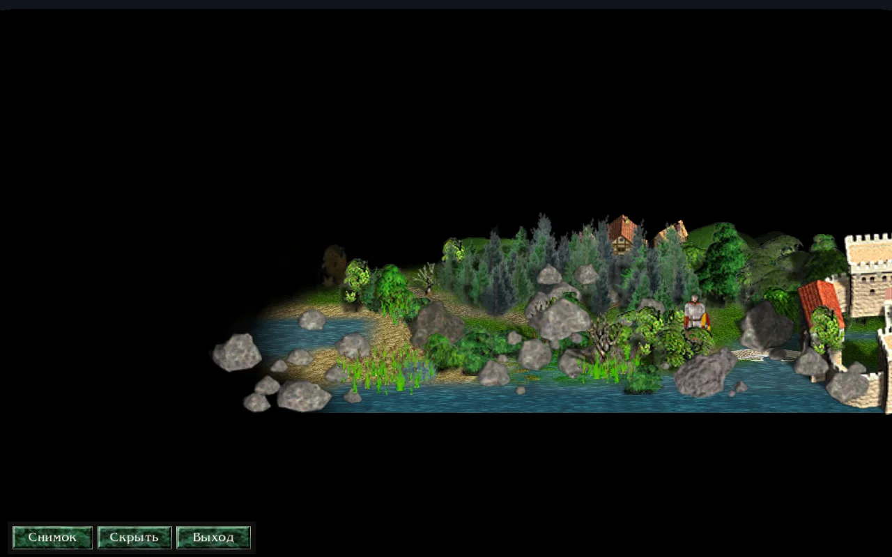
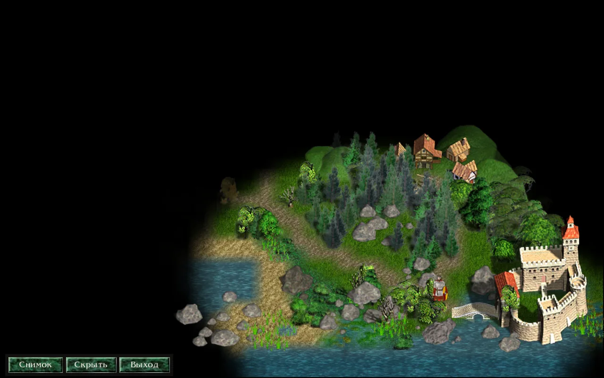
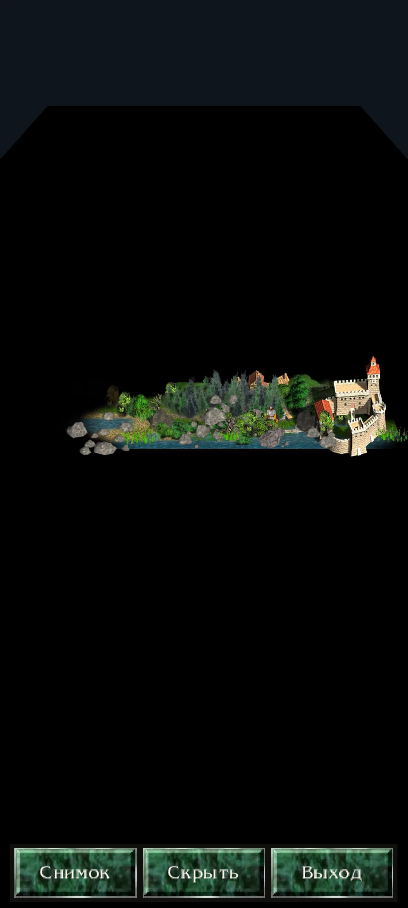

## How to turn it on

In the game menu on the map, press the "Photo" button. It is in the row of buttons: "Quit the game", "Exit to menu", "Restart", "Photo", "Cancel".

:::note
On a computer, the P key turns the mode on too. You can change that key in "Settings" → "Controls" → "Keys…".
:::

On a phone, the mode is turned on by the "Photo" button in the game menu (in the row of six buttons).

## What happens in the mode

The game stands still. Time does not pass, the hero does not walk, no events happen, and the AI does not move. The fog of war, the armies and the buildings stay as they are in the game.

Only a small panel with three buttons stays on screen: "Shot", "Hide the strip" and "Exit photo mode".

When you leave the mode, the map's view goes back to how it was in the game.

## The camera

**On a computer:**
*   Left mouse button, drag: pans the map.
*   Right mouse button, drag: turns and tilts the camera.
*   Mouse wheel or + / −: zooms in and out.
*   Q and E: turn the camera.
*   PageUp and PageDown: tilt the camera (hold the key).
*   Arrow keys: pan the map (hold the key).

**On a phone:**
*   One finger: pans the map.
*   Two fingers, pinch and spread: zoom in and out.
*   Two fingers, twist: turns the map.
*   Two fingers, slide up and down: tilts the camera.

## The panel

The panel has three buttons:

*   **"Shot"**: takes a picture of the map.
*   **"Hide the strip"**: hides the panel for a clean picture. A click on the map, or Esc, brings the panel back.
*   **"Exit photo mode"**: leaves the mode.

:::tip
On a computer, Space or Enter also takes a shot. The P key leaves the mode at any time; Esc leaves it while the panel is on screen.
:::

## Shots

A shot is saved as a PNG. It has no panel and no mouse pointer on it.

The shots are kept in the `photos` folder inside Razdor's data folder:
*   On Linux: `~/.local/share/razdor/photos`
*   On Android: `/storage/emulated/0/Razdor/photos`

The file name looks like `razdor-YYYY-MM-DD-HH-MM-SS.png`. If you take a second shot in the same second, a number is added (-2, -3).

After a shot, a line with the file name appears at the bottom of the screen.

:::caution
On Android, shots do not appear in the phone's gallery straight away. Find them in a file manager.
:::

## Differences from the original

The original "Discord Times" has no photo mode. Razdor adds it.

Nothing in the game changes: the mode does not let the hero move, does not change saves and does not change the rules.
