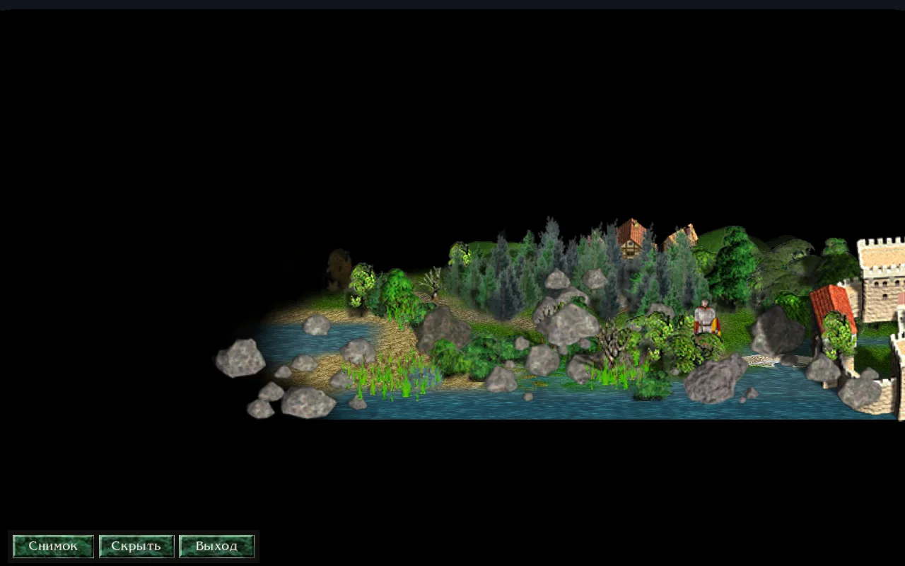

There are two ways to record a video from the game.

- **Quick.** For all, on computer and on phone. Record the game and view it on the viewer screen, take photos in photo mode, and record the screen with any program.
- **Cinematic.** For computer. You write a scene file: a text file where the camera moves over the map, the hero walks along the road, and days pass. Razdor renders it into an MP4 with sound.

## Quick Method

### Game Recording and Viewing

In the settings, under "Other," there is "Record the game." It is enabled by default, and recording does not change anything in the game.

You can watch the recording in three ways:

- "Watch the record" in the hero's diary: the recording of the current game.
- "Watch the record" on the "Summary" page after the map or the hero's fall.
- "Record" in the load window: the recording of the chosen save.

On the watching screen, you can play and pause, change the speed from 1× to 16×, move the camera with the mouse wheel, the `+` and `-` keys, the arrow keys or a mouse drag. "Follow the hero" keeps the camera on the hero. The timeline at the bottom: a click moves the recording to the day you clicked, and marks show battles, towns taken and the hero's fall. See more on the [Game Recordings](/razdor/wiki/en/tutorials/replays/) page.

:::note
Music does not play when viewing a recording, so it will not be included in the video either.
:::

### Photo Mode

Photo mode pauses the game: time does not pass, the hero does not walk, and events do not happen. On the computer, it is activated by the `P` key or the "Photo" button in the game menu. On the phone, by the "Photo" button in the game menu on the map.



A panel remains at the bottom: "Shot," "Hide the strip," and "Exit photo mode." The camera is moved the same way as on the viewer screen: on the computer, the map is dragged with the left mouse button, rotated and tilted with the right, and zoomed with the mouse wheel. On the computer, a snapshot is taken with Space or Enter. The `P` key exits the mode at any time.

Snapshots are saved in PNG format, without the panel and without the mouse cursor. They are located in the `photos` folder in the Razdor data folder: in Windows `%APPDATA%\razdor\photos`, in Linux `~/.local/share/razdor/photos`. See more on the [Photo Mode](/razdor/wiki/en/tutorials/photo/) page.

### Screen Recording

Use any screen recording program: OBS Studio on the computer or the built-in screen recorder on the phone. Razdor does not record the screen itself.

## Cinematic Method

:::note
This is a developer tool, not a menu item. It is activated by the command-line argument `--trailer` and does not change anything in the game for the regular player. It works on computer, in Windows and Linux.
:::

What you need:

1. Razdor program: `Razdor.exe` on Windows, `razdor` on Linux.
2. Installed Discord Times game. On Windows, place `Razdor.exe` in the folder with `DiscordTimes.exe`, and the game will be found automatically. In other locations, specify the installation folder in the `RAZDOR_DT_DIR` environment variable or in the `.env` file next to the program.
3. `ffmpeg` program, available from the command line. It creates MP4 and mixes audio. Without it, `--preview` and MP4 recording will not start.

### 1. Find Shots in Flyover Mode

Flyover mode launches Razdor live, without a scene file: you move the camera and look for an angle. Launch commands are in the [«Commands for Windows and Linux»](#commands-for-windows-and-linux) section. The default map is the first map of the campaign; another one can be selected using the `RAZDOR_TRAILER_FLY_MAP` variable with the map name.

| Key | Action |
|---|---|
| `W`, `A`, `S`, `D` | move the view point on the ground; faster with `Shift` |
| `Q` and `E` | change distance to the hero |
| Right mouse button, drag | rotates (horizontally) and tilts (vertically) |
| Mouse wheel | changes field of view |
| `F8` | prints the camera as a string `at` |

Found a shot? Press `F8`. The line `at 3.00s pitch=… yaw=… dist=… fov=… target=x,y` is printed in the terminal (on Linux) and is always written to the `razdor.log` file in the data folder. Copy `pitch`, `yaw`, `fov`, and `target` to the scene file, and replace `dist` with `fit=1`. `fit=1` is the classic scale; then adjust the value by eye using `--preview`.

### 2. Scene File

The scene file is a text file. One line is one element, `#` starts a comment. The `map` line and at least one time line (`at`, `walk`, `pass`) are mandatory. Spaces in map names are allowed.

Main lines:

| Line | Action | Default |
|---|---|---|
| `map <name>` | map by its file name, without `.DTm` | mandatory |
| `hero knight`, `archmage`, `ranger` | hero: knight, archmage, or ranger | `knight` |
| `seed <number>` | event seed: the same seed gives the same events | `24301` |
| `size <width>x<height>` | frame size | `1920x1080` |
| `fps <number>` | frames per second, from 1 to 120 | `60` |
| `duration <seconds>` | video length | time of the last line |
| `at <time> <keys>` | camera keyframe | none |
| `walk <time> <x>,<y> <x>,<y> ...` | hero walks across cells at normal pace | none |
| `pass <time> <n>d` or `<n>h` | passes time: armies march, days and events | none |
| `reveal <time> <x>,<y> <radius>` | reveals cells around a point | none |
| `ui on`, `fog on` | show interface and fog of war | `off` |
| `music off` | remove music, sound effects remain | `on` |
| `event <number> <choice>` | answer to an event question: `0` first button, `1` second | `0` |
| `battles map`, `show` | battle takes place on the map or is shown on the battle screen | `map` |

The full list of lines and keys, with `look`, `hour`, `view`, and `lang`, is in the [docs/trailer-shots.md](https://github.com/indicozy/razdor/blob/main/docs/trailer-shots.md) file.

Camera keys in `at` lines:

| Key | Action |
|---|---|
| `pitch` | downward tilt of view, from 0 to 90 degrees; `90` gives top-down view, 0 to 5 the eyes view |
| `fit` | distance in classic scale: `1` gives normal scale at any window size |
| `fov` | field of view, from 5 to 120 degrees (default 35) |
| `yaw` | rotation: 0 looks north, 90 looks west |
| `target` | view point: cell `x,y`, hero `hero`, hero with offset `hero+0,-4` or army `army:<number>` |
| `bend`, `radius` | curve of the distant land; `bend=0` without curve |
| `width`, `ahead`, `behind` | how much land is visible on the sides, in front, and behind; for low views, they must be set together with `bend`, e.g., `bend=78 width=120 ahead=200 behind=60` |
| `ease` | how the transition to this frame occurs: `linear`, `in`, `out`, or `inout` (default) |
| `eye=1`, `height`, `horizon` | hero's eye view; `height` is eye height in cells, `horizon=1` means the distant land goes to the horizon |

Time: frame `i` corresponds to `i / fps` seconds, so the same file gives the same video. The hero crosses a cell in a quarter of a second, and one day in `pass` takes about 7 seconds.

### 3. Scene Example

The example lasts 26 seconds on the map "РК1-Начало пути" (the map's own name in the install). The hero leaves the castle, the camera descends from a top-down view to a low view, then a day passes. Save it as `my.shot`:

```text
# Example: the hero leaves the castle, the camera descends from the top-down map view to a low view,
# then a day passes. 26 seconds, 1280x720, 30 frames per second.
map РК1-Начало пути
hero knight
seed 1204
size 1280x720
fps 30
reveal 0s 30,38 14
walk 0.5s 36,41 33,38 28,36 24,33
at 0s pitch=90 fit=1 target=hero
at 6s pitch=72 fit=0.95 target=hero+0,-2
at 11s pitch=40 fit=0.8 bend=30 width=120 ahead=200 behind=60 target=hero+0,-4
at 16s pitch=12 fit=0.6 bend=78 width=120 ahead=200 behind=60 target=hero+0,-5
pass 17s 1d
at 26s pitch=12 fit=0.6 bend=78 width=120 ahead=200 behind=60 target=hero+0,-5
duration 26
```

- `map`, `hero`, `seed` set the map, hero, and events. The same seed means the same events.
- `size 1280x720` and `fps 30` — 1280x720 frame and 30 frames per second. This size fits on a normal screen.
- `reveal 0s 30,38 14` reveals cells around the castle.
- `walk 0.5s ...` moves the hero across four cells, starting at 0.5 seconds.
- The four `at` lines sequentially lower the camera: from `pitch=90` (top-down view) to `pitch=12` (low view). For low views, `bend`, `width`, `ahead`, and `behind` are set.
- `pass 17s 1d` passes a day from the 17th second; the last `at 26s` holds the frame until the end.
- `duration 26` — video length.

The cells of the path must be on the map. `--plan` will show where the hero and armies are, and warn if something is wrong.

### 4. Checking: --plan and --preview

```sh
# Linux
./razdor --trailer my.shot --plan
# Windows (Command Prompt)
Razdor.exe --trailer my.shot --plan
```

`--plan` does not draw anything. It prints where the hero and armies are in each keyframe, what events occurred and how they were answered, as well as warnings. The same report is written to the log.

If the report is okay, do a quick preview:

```sh
# Linux
./razdor --trailer my.shot --preview --out preview.mp4
# Windows (Command Prompt)
Razdor.exe --trailer my.shot --preview --out preview.mp4
```

This is an MP4 of 640 pixels wide, one frame out of ten. It is needed to see the composition and adjust `fit` and `pitch`.

### 5. Recording MP4

```sh
# Linux
./razdor --trailer my.shot --out my.mp4
# Linux, without an NVIDIA card (the processor encodes)
./razdor --trailer my.shot --out my.mp4 --encoder libx264
# Windows (Command Prompt)
Razdor.exe --trailer my.shot --out my.mp4
```

- The MP4 appears in the folder where you ran the command. You can specify the full path in `--out`; the required folder is created automatically.
- A game window of the required size opens during recording. Do not touch it until the recording is finished.
- There are as many frames as specified in the file. A long video just takes more time.
- By default, the recording uses the NVIDIA encoder (`h264_nvenc`), which is faster. Without an NVIDIA card, add `--encoder libx264`: it calculates on the processor, slower, but works without NVIDIA.
- Sound effects and music are mixed into the MP4 (AAC). The `music off` line removes music, effects remain.

### Tips for a Lively Shot

- **Top-down Descent.** Gradually decrease `pitch`, from `90` to low view, and add `bend`, as in the example.
- **Orbit.** Set `yaw=0` and then `yaw=360` after 12 seconds with `ease=linear`: a smooth circle around the hero.
- **Time Acceleration.** Top-down view plus `pass` for several days: armies march across the map.
- **Army Tracking.** `target=army:<number>` keeps the camera on the army while it moves. The number will be shown in `--plan`.
- **Hero's Eyes.** `eye=1`, `height=0.7`, `horizon=1`, and `pitch=2` with `walk` give a first-person view.

### Commands for Windows and Linux

Run the commands in the folder where the scene file is located. If `Razdor.exe` is in a different folder, specify the full path to it.

**Linux**, in the terminal (`RAZDOR_TRAILER_FLY=1` enables flyover mode for one run):

```sh
RAZDOR_TRAILER_FLY=1 ./razdor
```

To keep the variable for the whole terminal session, run `export RAZDOR_TRAILER_FLY=1` first.

**Windows**, Command Prompt (`set` only affects this window):

```bat
set RAZDOR_TRAILER_FLY=1
Razdor.exe
```

**Windows**, PowerShell:

```powershell
$env:RAZDOR_TRAILER_FLY = "1"
.\Razdor.exe
```

In Windows, the program runs without a terminal window, so the `--plan` report and the `F8` line are placed in the `razdor.log` file in the `%APPDATA%\razdor` folder.

## If Something Doesn't Work

- **File Error.** It is printed before the recording starts, with the line number and field, for example:

  ```text
  shot.shot:
    line 4: pitch: 95: from 0 to 90 (90 is the top-down view, 0 to 5 the eyes view)
  ```

- **`ffmpeg` not found.** Install it and add it to the `PATH` variable.
- **NVIDIA recording fails.** Add `--encoder libx264`.
- **`--plan` reports no armies.** The camera has no target in this keyframe. Change `target` or time.

:::tip
First `--plan`, then `--preview`, and only then the full recording. The first two steps take noticeably less time than the full recording.
:::

See also: [Game Recordings](/razdor/wiki/en/tutorials/replays/), [Photo Mode](/razdor/wiki/en/tutorials/photo/), and [all tutorials](/razdor/wiki/en/tutorials/).
