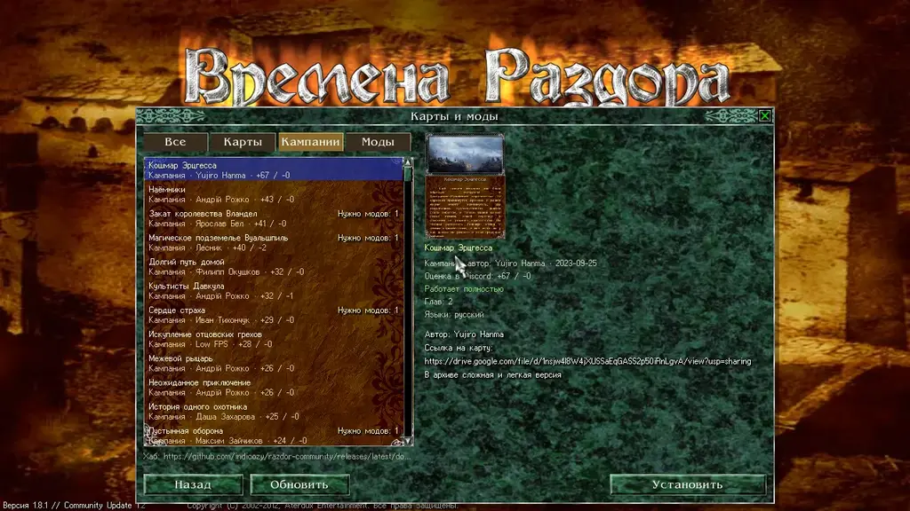

В главном меню откройте окно «Карты и моды». Там собраны карты, кампании и моды сообщества с сервера Discord: 289 карт, 56 кампаний и 25 модов. Всё это ставится прямо из игры.

## Вкладки

Записи разделены на вкладки:

* **Все**
* **Карты**
* **Кампании**
* **Моды**

В списке каждая запись показывает свой вид (карта, кампания или мод), автора, оценку из Discord (👍 и 👎) и состояние. Записи сортируются по оценке: лучшие сверху. Записи без поста в Discord стоят в конце, по названию.

## Поиск

Над списком есть поле «наберите для отбора»: введите часть названия (русского или английского) или имя автора, и список сузится; крестик справа или Esc очистят поле.

## Открыть запись

Выберите запись, и справа откроется её описание:

* картинка;
* автор, версия и дата;
* оценка в Discord;
* как она работает: «Работает полностью» или «Работает частично» с пояснением;
* языки;
* описание из поста автора в Discord.

Если у карты есть своя картинка и своя история (вступление из самой карты), показываются они, а текст поста автора — ниже, под заголовком «Из поста автора».

На телефоне, который держат вертикально, описание открывается вместо списка карточкой: картинка во всю ширину с названием поверх неё, под ней автор и сведения в рамочках, затем история и пост автора; «К списку» возвращает к списку.

## Установка и удаление

* **«Установить»** скачивает запись вместе с модами, которые ей нужны.
* **«Убрать»** убирает запись. Мод не убирается, пока установленная запись в нём нуждается.
* **«Обновить»** заново читает каталог.

## Версии пакетов

Пакет можно поставить в нескольких версиях. Каждая установленная версия остаётся на компьютере: новая версия не удаляет старую.

* Версию выбирают в карточке пакета в «Картах и модах» или на странице пакета в окне новой игры. Список версий виден, когда установлено больше одной.
* По умолчанию выбрана версия, которой вы играли в последний раз. Если вы её ещё не запускали, выбрана самая новая.
* Если установлена новая версия, которой вы ещё не играли, рядом с пакетом стоит отметка «Новая версия». Она пропадает, когда вы начинаете игру на самой новой версии.
* Если в каталоге есть версия, которой у вас нет, на карточке появляется кнопка «Установить X.Y.Z». Она ставит эту версию рядом со старыми.
* Сохранение открывается на той версии, на которой его начали; выбор версии влияет только на новые игры.
* **«Убрать»** убирает все установленные версии пакета.

## Откуда карты

Каталог взят с форумов Discord-сервера сообщества: разделы «сокровищница-модов» и «библиотека-карт». Материалы публикуются с разрешения администраторов сервера, и у каждой записи указан автор со ссылкой на его тему.

Сам каталог лежит в релизах [razdor-community](https://github.com/indicozy/razdor-community). Моды там хранятся только как отличия от Community Update. Ваша копия игры не меняется и по-прежнему нужна. Музыка в модах перекодирована в Ogg Vorbis, чтобы загрузки были меньше.

Окно открывается сразу: список берётся из копии, сохранённой при прошлом открытии, а новый список подгружается в фоне; без связи вы видите сохранённый список и строку «Нет связи: показан сохранённый список».

## Играть мод

В окне новой игры выберите мод в списке «Мод», он стоит внизу окна рядом с «Добавить карту…». Игра пойдёт на данных мода поверх обычной игры. Карты, которым нужен мод, видны только тогда, когда мод выбран. Карты обычной игры при выбранном моде идут в конце списка, в группе «Карты обычной игры»: она свёрнута, нажмите на её заголовок, чтобы раскрыть. Сохранения каждого мода хранятся отдельно. Зелёные галочки пройденных карт тоже хранятся для каждого мода: карта, пройденная под одним модом, отмечена только под ним, а без мода показываются галочки обычной игры.

## Частичные записи

Некоторые моды помечены «частично». Они поставляют свою изменённую программу игры (`DiscordTimes.exe` или `ddraw.dll`), которую Razdor не может использовать, либо они неполные. Такие моды играются, но не всё, что сделал автор, может работать.

Некоторые кампании тоже помечены «частично»: в них есть главы, которых нет ни в одном источнике.

## Убрать или исправить запись

Авторы просят убрать или поправить запись, написав на Discord или открыв issue в репозитории [razdor-community](https://github.com/indicozy/razdor-community).

:::note
Карты и моды делают авторы из сообщества; Razdor только собирает их в каталог и проверяет, что они открываются и играются.
:::

:::tip
Оценка в Discord — это рейтинг поста на сервере, а не оценка Razdor.
:::
