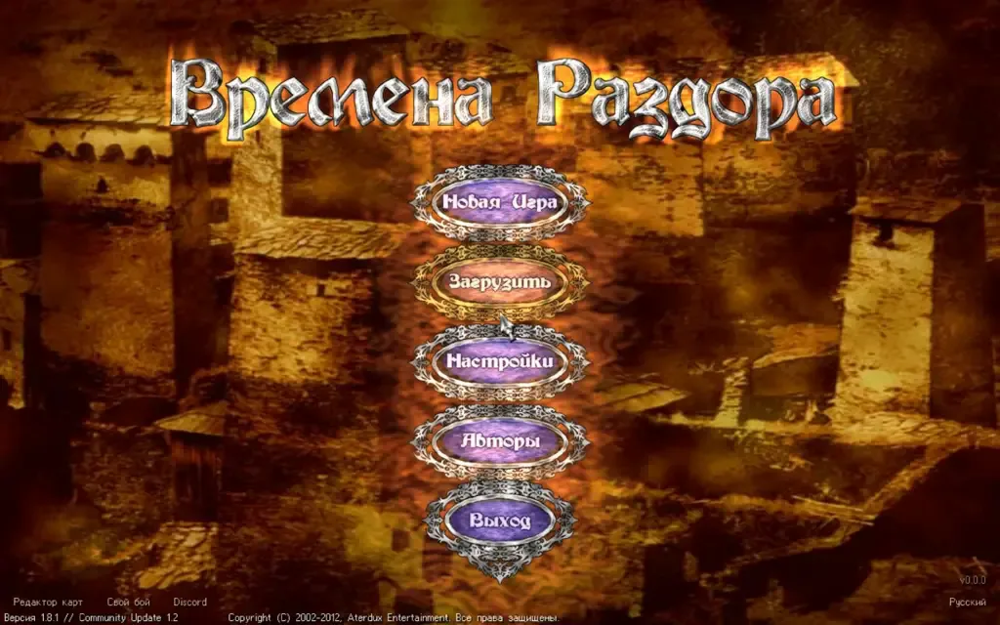

Программы Razdor выкладываются в выпусках (releases) на [GitHub](https://github.com/indicozy/razdor/releases). Для каждой системы нужен свой файл. Для игры понадобится ещё и своя копия *Discord Times*: см. [Установка игры](/razdor/wiki/start/install-game/). Без неё главное меню объяснит, что нужна копия игры.

## Windows

1. Скачайте `Razdor-<версия>.exe` из выпуска. Это один файл, без собственных DLL.
2. Положите его в удобную папку или рядом с `DiscordTimes.exe`.
3. Запустите двойным щелчком.

:::caution
Если появилось сообщение «WGL_ARB_pixel_format is required», на машине нет драйвера OpenGL 2. Так бывает в сеансе удалённого рабочего стола (RDP) и в виртуальных машинах. Razdor сам покажет совет, что делать.
:::

### Windows 7 и 8

Для Windows 7 и 8 есть отдельная сборка. Скачайте `razdor-<версия>-windows7.zip` из выпуска, распакуйте его рядом с `DiscordTimes.exe` и запустите `Razdor-win7.exe`. Windows 10 и новее используют обычный `Razdor-<версия>.exe`, как выше.

В сборке для Windows 7 нет поддержки геймпадов: мышь и клавиатура работают как обычно. Для загрузок в архиве лежит `curl.exe`; на Windows 7 он запускается только с обновлением KB2999226 (Universal C Runtime), которое ставится через Центр обновления.

## Linux

1. Скачайте `razdor-<версия>-linux` из выпуска.
2. Если система не даёт запустить файл, сделайте его исполняемым: `chmod +x razdor`.
3. Откройте терминал в папке с файлом и запустите: `./razdor-<версия>-linux`.

## macOS

1. Скачайте `razdor-<версия>-macos` из выпуска.
2. Программа не подписана разработчиком, и macOS блокирует её после скачивания. Перед первым запуском выполните в Terminal `xattr -d com.apple.quarantine razdor-<версия>-macos` или откройте программу через правую кнопку → Open в Finder.
3. Запуск двойным щелчком откроет программу в Terminal.

## Проверка загрузки

Сверьте SHA-256 файла с `SHA256SUMS` из того же выпуска, если хотите убедиться, что файл не повреждён.

## Мобильные устройства

Инструкции по установке на смартфоны доступны на отдельных страницах:

- [Android](/razdor/wiki/phones/android/)
- [iOS](/razdor/wiki/phones/ios/)

После запуска, если игра найдена, вы попадаете в главное меню оригинала.
