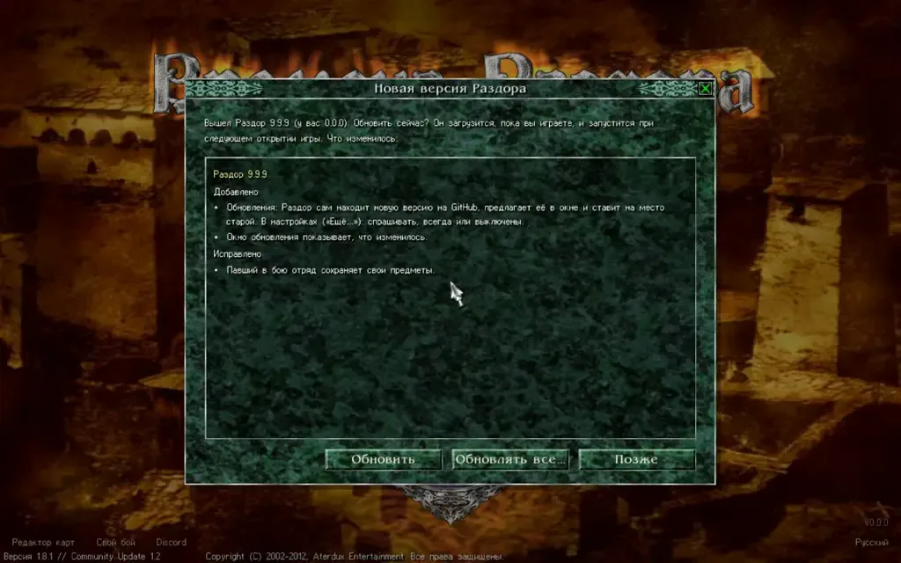

## Как работают обновления

При каждом запуске Razdor в отдельном потоке проверяет наличие новых выпусков на GitHub. Движок не ждёт ответа от сервера, поэтому процесс не мешает игре. Если новой версии нет, никаких уведомлений не появится.

Если обновление доступно, игра покажет специальное окно. Это окно может появиться только в «спокойный момент»:
* на титульном экране;
* в меню «Настройки»;
* на карте, когда нет других открытых окон.

:::caution
Никогда не ждите окна обновления во время боя — оно не появится.
:::

В окне отображается информация об изменениях относительно вашей текущей версии. Вы можете нажать кнопку **«Обновить»**, чтобы начать загрузку. Процесс происходит в фоновом режиме, пока вы играете. После загрузки движок сверяет файлы с `SHA256SUMS` и заменяет старые файлы новыми. Новая версия вступит в силу только после следующего запуска. На титульном экране также может появиться кнопка **«Перезапустить»**.

## Настройки обновлений

Вы можете изменить поведение системы через меню «Настройки» → «Ещё…» → «Обновления».

Доступные режимы:
* **«Спрашивать»** — режим по умолчанию. Появляется окно с предложением обновиться.
* **«Всегда»** — обновления проверяются и скачиваются без показа окна. Режим **«Обновлять всегда»** в самом окне уведомления также переключает настройку на этот вариант.
* **«Выключены»** — автоматическая проверка отключена.

Также здесь есть кнопка **«Проверить»** для принудительного запуска поиска новой версии.

:::note
Для работы системы обновлений в вашей системе должен быть установлен `curl` (он встроен в Windows 10 и новее, macOS и большинство дистрибутивов Linux).
:::

## Ручная проверка (для разработчиков)

Если вы запускаете сборку через `cargo`, движок не будет проверять наличие обновлений.

Чтобы протестировать процесс обновления на настоящих выпусках, можно использовать переменную окружения `RAZDOR_UPDATE_AS`. Если установить её значение, например, `RAZDOR_UPDATE_AS=0.3.0`, движок будет считать, что текущая версия — 0.3.0, и сможет найти более новые выпуски на GitHub.
