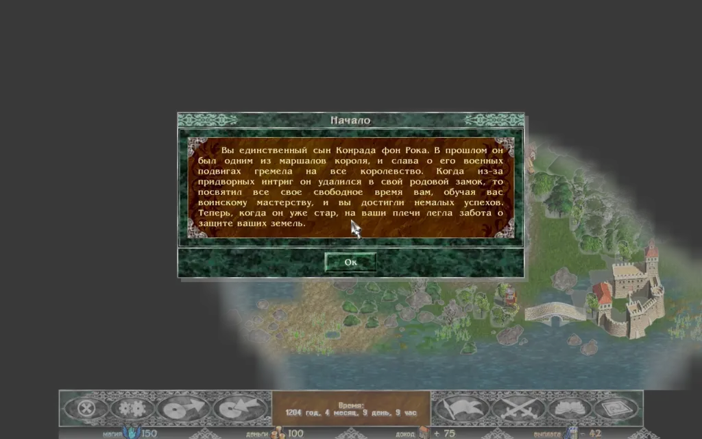
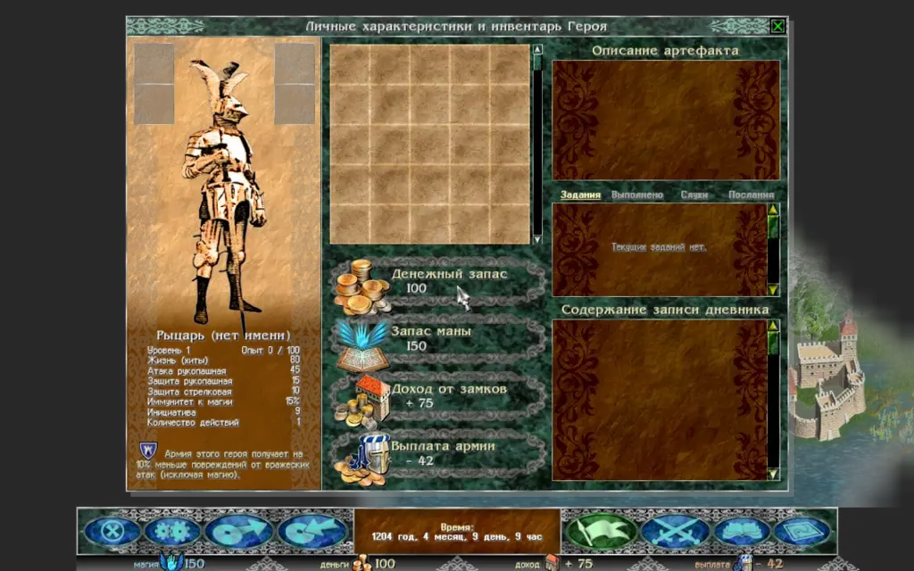
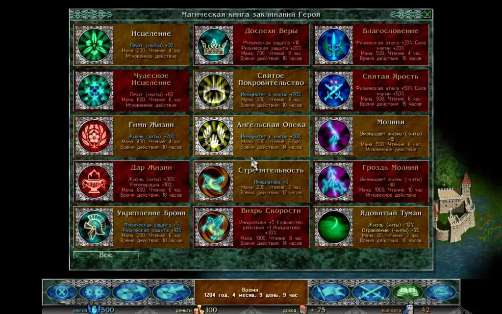

Экраны Razdor повторяют раскладку оригинала: карта занимает основную часть экрана, а управление идёт через кнопки нижней панели и окна.

## Нижняя панель

Кнопки на панели овальные, как в оригинале, и их цвет показывает состояние:

* **Синие** — обычные кнопки.
* **Серые** — пока открыто какое-либо окно.
* **Зелёные** — экран этой кнопки открыт.
* **Оранжевые** — пока показана мини-карта.

Слева направо: меню (**«Главное меню (Esc)»**), **«Настройки звука»**, сохранение, загрузка. Справа: журнал (кнопка-флаг, открывает дневник героя), герой и армия, книга заклинаний и карта. Посередине панель времени, под ней — мана, золото, доход и жалованье.

:::tip
Чтобы вернуть масштаб интерфейса в режим «Авто», нажмите `Ctrl+0` на любом экране.
:::

## Мини-карта

Мини-карта — окно с уменьшенной картой всего сценария. Исследованные клетки показаны цветом местности, неисследованные — чёрным. Города и места отмечены значками, армии и герой — щитками, светлый прямоугольник показывает часть карты на экране.

Открыть её можно кнопкой **«Карта сценария (M)»** на нижней панели (кнопка становится оранжевой, пока мини-карта открыта) или клавишей `M`. Клавиша `M` её и закрывает; `Esc` тоже закрывает её раньше меню игры.

По умолчанию она стоит в правом верхнем углу. Перетащите её за рамку в любой другой угол; потяните за край, чтобы изменить размер.

В настройках, на вкладке **«Карта»**:

* **«Угол миникарты»** переносит её в следующий угол (по часовой стрелке);
* **«Место миникарты»** с кнопкой **«Сбросить»** возвращает размер и место по умолчанию;
* **«Список у миникарты»** показывает список армий рядом с картой.

:::note
На компьютере, если нижняя панель не занимает всю ширину экрана, мини-карта может встать в свободный угол рядом с панелью, не касаясь её.
:::

## Окно героя и дневник

Окно героя и армии открывается кнопкой **«Герой и его армия»** на панели или клавишей `A`. Дневник героя открывается флагом на нижней панели или клавишей `J`.

Дневник разделён на пять вкладок:

1. **«Задания»** — текущие задания, как в оригинале.
2. **«Выполнено»**, **«Слухи»** и **«Послания»** — история Razdor с игровой датой. Новые записи сверху, а сюжетные сообщения скриптовых событий попадают в «Послания». Это дополнение Razdor: в оригинале дневник показывает только текущие задания.
3. **«Летопись»** — записи по дням о том, что видел и делал игрок: события, битвы, найм, задания. Кнопка «Итоги» вверху списка открывает страницу с путём героя и цифрами ([подробнее](/razdor/wiki/differences/chronicle/)).

Чтобы прочитать запись целиком, выберите её.

## Книга заклинаний

Книга открывается кнопкой **«Книга заклинаний (B)»** на панели или клавишей `B`. В книгу помещается до 15 заклинаний. Заклинания изучаются за золото в святилище (вкладка «Святилище» в городах и храмах).

Для каждого заклинания видны:

* стоимость в мане;
* время, которое нужно на сотворение;
* длительность действия;
* эффект.

:::caution
Сотворение заклинания тратит не только ману, но и игровое время. Пока герой колдует, вражеские армии продолжают движение, и враг, добравшийся до вас, срывает заклинание.
:::

## Экран битвы

Битва открывается поверх карты. В заголовке окна указаны названия обеих армий.

* **Ваш строй** — внизу окна, **строй врага** — вверху.
* **Карточки воинов** показывают портрет и полосу характеристик: `A` (атака), `D` (защита), `Ini` (инициатива), `Mnvr` (число действий), `Hits` (жизни), `Pwr` (сила у магов).
* **Подсказка** при наведении на цель показывает действие заранее, например «Щёлкните, чтобы проклясть: Инициатива: -5».
* **Пустые клетки** показывают мечи (передний ряд), лук (задний ряд) или шатёр (резерв).

Карточка воина, который ходит, обведена зелёным. Клетки, куда он может шагнуть, подсвечены синим, а его цели — красным (зелёным под мышью) или синим.
