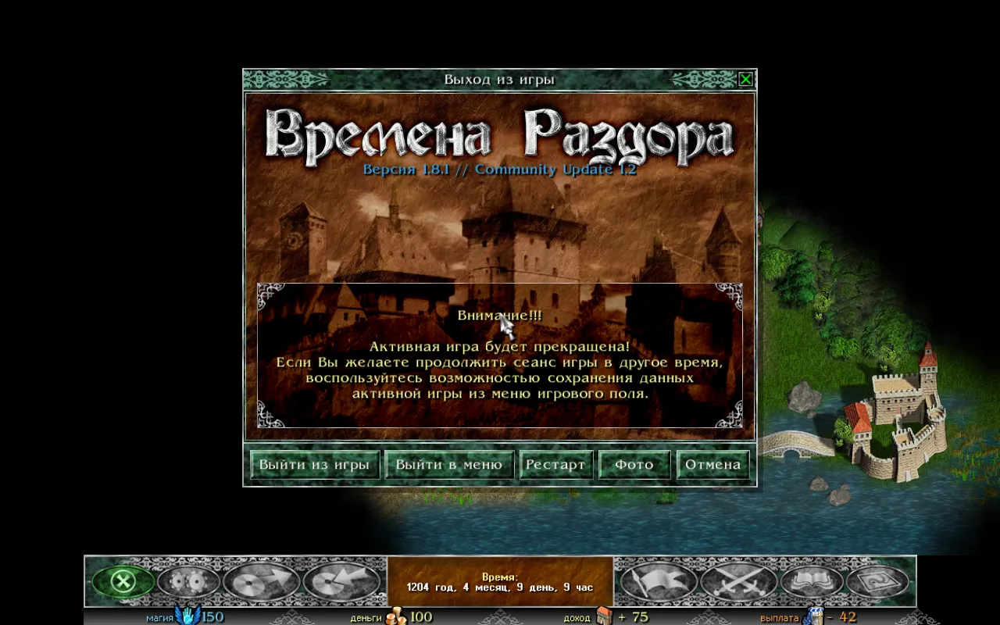
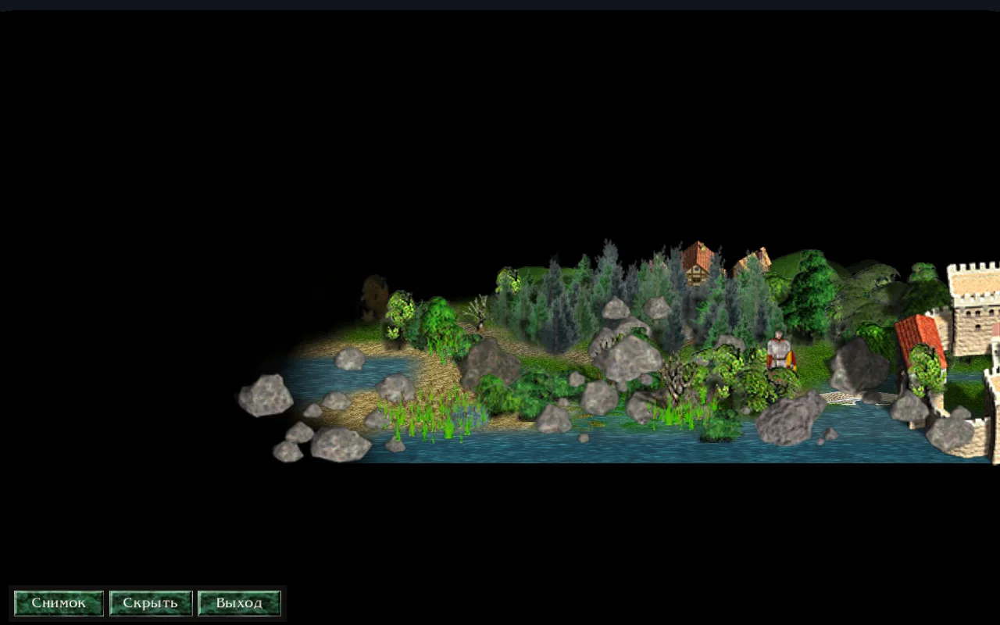
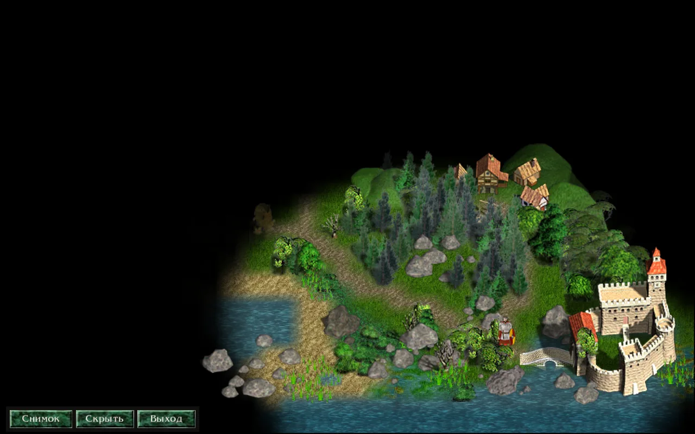
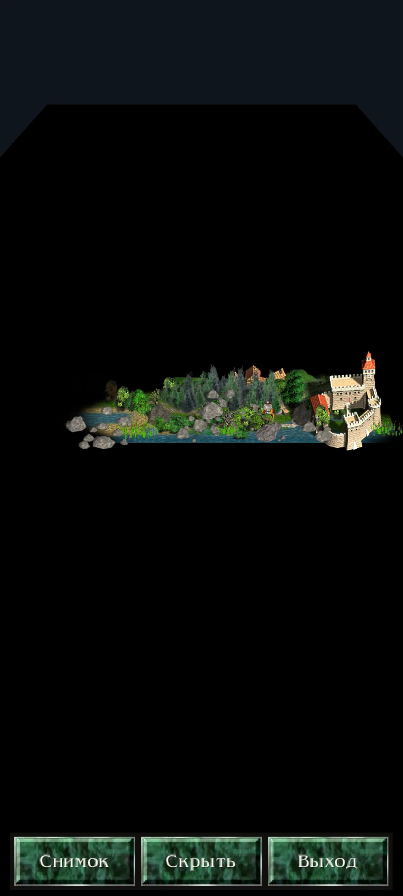

## Как включить

В меню игры на карте можно найти кнопку «Фото». Она находится в ряду кнопок: «Выйти из игры», «Выйти в меню», «Рестарт», «Фото», «Отмена».

:::note
На компьютере режим можно включить клавишей P. Эту клавишу можно поменять в «Настройки» → «Управление» → «Клавиши…».
:::

На телефоне режим включается кнопкой «Фото» в меню игры (в ряду из шести кнопок).

## Что стоит в режиме

Игра останавливается. Время не идёт. Герой не ходит. События и ходы ИИ не происходят. Туман войны, армии и здания остаются как в игре.

Остаётся маленькая панель с тремя кнопками: «Снимок», «Скрыть», «Выход».

Когда вы выходите из режима, вид карты возвращается к тому, каким был в игре.

## Камера

**На компьютере:**
*   Левая кнопка мыши, протянуть: сдвигает карту.
*   Правая кнопка мыши, протянуть: поворачивает и наклоняет.
*   Колесо мыши или + / −: приближает и отдаляет.
*   Q и E: поворот.
*   PageUp и PageDown: наклон (нужно держать).
*   Стрелки: сдвиг карты (нужно держать).

**На телефоне:**
*   Один палец: сдвиг карты.
*   Два пальца, сведение и разведение: приближение и отдаление.
*   Два пальца, поворот: поворот карты.
*   Два пальца, движение вверх и вниз: наклон.

## Панель

На панели есть три кнопки:

*   **«Снимок»**: Делает снимок карты.
*   **«Скрыть»**: Убирает панель для чистого кадра. Щелчок по карте или нажатие Esc вернёт панель.
*   **«Выход»**: Выходит из режима.

:::tip
На компьютере Пробел или Enter тоже делают снимок. Клавиша P выходит из режима в любой момент, Esc выходит, пока панель на экране.
:::

## Снимки

Снимок сохраняется в формате PNG. На нём нет панели и нет указателя мыши.

Снимки лежат в папке `photos` в папке данных Раздора.
*   На Linux: `~/.local/share/razdor/photos`
*   На Android: `/storage/emulated/0/Razdor/photos`

Имя файла выглядит так: `razdor-ГГГГ-ММ-ДД-ЧЧ-ММ-СС.png`. Если снимок сделан в ту же секунду, добавляется номер (-2, -3).

После снимка внизу экрана появляется надпись с именем файла.

:::caution
На Android снимки не появляются сразу в галерее телефона. Используйте файловый менеджер.
:::

## Отличия от оригинала

В оригинале «Discord Times» режима фото нет. Это добавили в Раздоре.

В игре ничего не меняется. Режим не даёт ходить, не меняет сохранения и не меняет правила.

Для видео с камерой и ходами героя см. [Как снять видео](/razdor/wiki/tutorials/video/).
