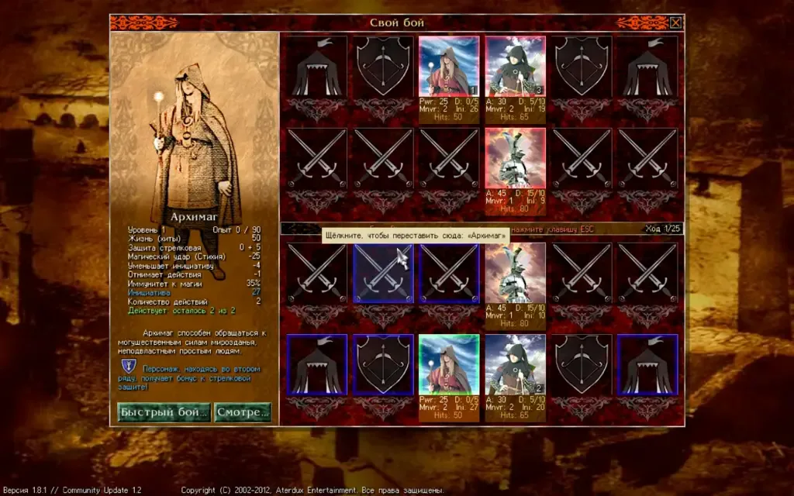
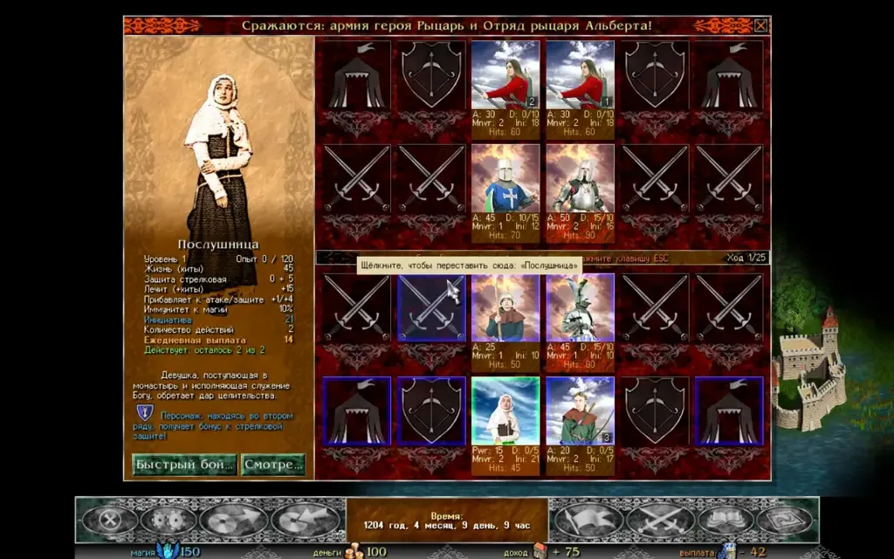

## Быстрый бой

Дополнение Razdor, как автобой в других стратегиях. Когда битва открылась и никто ещё не ходил, **«Быстрый бой»** (`Q` или `Enter`) разыгрывает её за обе стороны боевым ИИ. Если битва уже начата, **«Доиграть самим»** (`Q`) доигрывает оставшуюся часть.

* **Правила:** ваши воины играют по тем же правилам, что и ИИ: один ход резерва за ход, никогда в резерв.
* **Итоги:** сразу появляется окно итогов. Битва засчитывается полностью: потери, опыт и уровни, добыча, захваченные замки, последующие события.
* **Смотреть:** клавиша `W` запускает просмотр на экране битвы. ИИ играет за обе стороны, ход за ходом, с обычной анимацией.
* **Темп:** `S` или кнопка темпа переключают 1×, 2× и 4×.

:::tip
**«К концу»** (`Q`) сразу завершает просмотр с тем же итогом. **«Управлять»** (`W`) возвращает вам воинов там, где остановился просмотр.
:::

## Свой бой

**«Свой бой»** в углу главного меню открывает подготовку битвы вне кампании.

1. **Воины:** на вкладке **«Воины»** слева щёлкните по типу, чтобы добавить его в армию (она обведена золотом). Всего в строе до 12 клеток. Своя армия внизу экрана, армия врага вверху.
2. **Уровни:** кнопками `−` и `+` задайте уровень каждому воину, от 1 до 30.
3. **Предметы:** щёлкните по воину, чтобы открыть вкладку **«Предметы»**. Кнопки сверху оставляют один вид (оружие, доспехи, шлемы, щиты, кольца, амулеты), кнопка **«Цена»** сортирует по цене. Строка отбора (щелчок по ней или `Ctrl+F`) ищет предмет по словам.

:::note
Подготовка боя не влияет на основную игру и сохранения: опыт, добыча и боевые счётчики не меняются.
:::

### Параметры битвы

Перед боем нажмите **«В бой!»** (`Enter`). Можно настроить:

* **Строй:** широкий ряд из 6 или обычный 3 × 4;
* **Силу ИИ в бою:** обычный, улучшенный или «Максимум»;
* **Управление:** за каждую сторону играете вы или ИИ.

В окне итогов доступны **«Ещё раз»** (`Enter`), **«Сменить армии»** (`Esc`) и **«Главное меню»**.

## Код боя

Настройки боя можно передать другому игроку текстовой строкой.

1. Нажмите **«Скопировать код боя»** (или `Ctrl+C`). В буфер попадает строка вида `RZB1:…`.
2. Другой игрок вставляет её в своём окне боя кнопкой **«Вставить код боя»** (или `Ctrl+V`).

:::caution
Если код сделан на другой установке или с другим модом, игра предупредит. Воины и предметы, которых нет у получателя, пропускаются.
:::
