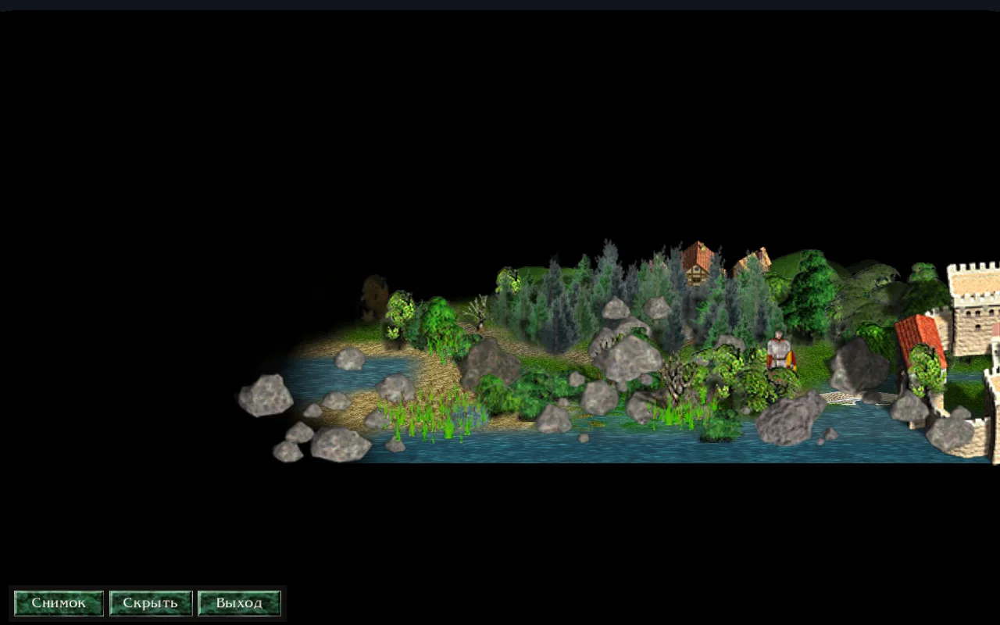

Есть два способа снять видео из игры.

- **Быстрый.** Для всех, на компьютере и на телефоне. Запишите игру и посмотрите её на экране просмотра, сделайте снимки в режиме фото, а экран запишите любой программой.
- **Кинематографический.** Для компьютера. Вы пишете файл сцены: текстовый файл, в котором камера едет над картой, герой идёт по дороге, а дни проходят. Razdor рендерит его в MP4 со звуком.

## Быстрый способ

### Запись игры и просмотр

В настройках, в разделе «Прочее», есть «Записывать игру». По умолчанию она включена, и запись ничего в игре не меняет.

Посмотреть запись можно тремя способами:

- «Смотреть запись» в дневнике героя: запись текущей игры.
- «Смотреть запись» на странице «Итоги» после карты или падения героя.
- «Запись» в окне загрузки: запись выбранного сохранения.

На экране просмотра можно играть и ставить на паузу, менять скорость от 1× до 16×, двигать камеру колесом мыши, клавишами `+` и `-`, стрелками или перетаскиванием. «Следить за героем» держит камеру на герое. Шкала внизу: щелчок переводит запись на нужный день, а метки показывают битвы, взятые города и падение героя. Подробнее — на странице [Записи игры](/razdor/wiki/tutorials/replays/).

:::note
При просмотре записи музыка не играет, поэтому в видео она тоже не попадёт.
:::

### Режим фото

Режим фото останавливает игру: время не идёт, герой не ходит, события не происходят. На компьютере он включается клавишей `P` или кнопкой «Фото» в меню игры. На телефоне — кнопкой «Фото» в меню игры на карте.



Внизу остаётся панель: «Снимок», «Скрыть» и «Выход». Камеру двигают так же, как на экране просмотра: на компьютере левой кнопкой мыши сдвигается карта, правой поворачивается и наклоняется, колесом мыши приближается. На компьютере снимок делают также Пробел или Enter. Клавиша `P` выводит из режима в любой момент.

Снимки сохраняются в формате PNG, без панели и без указателя мыши. Лежат они в папке `photos` в папке данных Razdor: в Windows `%APPDATA%\razdor\photos`, в Linux `~/.local/share/razdor/photos`. Подробнее — на странице [Режим фото](/razdor/wiki/tutorials/photo/).

### Запись экрана

Для записи видео используйте любую программу для записи экрана: OBS Studio на компьютере или встроенную запись экрана на телефоне. Razdor сам экран не записывает.

## Кинематографический способ

:::note
Это инструмент для разработчиков, а не пункт меню. Он включается аргументом командной строки `--trailer` и ничего в игре для обычного игрока не меняет. Работает на компьютере, в Windows и Linux.
:::

Что нужно:

1. Программа Razdor: `Razdor.exe` в Windows, `razdor` в Linux.
2. Установленная игра Discord Times. В Windows положите `Razdor.exe` в папку с `DiscordTimes.exe`, и игра найдётся сама. В других местах укажите папку установки в переменной `RAZDOR_DT_DIR` или в файле `.env` рядом с программой.
3. Программа `ffmpeg`, доступная из командной строки. Она создаёт MP4 и смешивает звук. Без неё `--preview` и запись MP4 не начнутся.

### 1. Найдите кадры в режиме полёта

Режим полёта запускает Razdor живую, без файла сцены: вы двигаете камеру и ищете ракурс. Команды для запуска — в разделе [«Команды для Windows и Linux»](#команды-для-windows-и-linux). Карта по умолчанию — первая карта кампании; другую можно выбрать переменной `RAZDOR_TRAILER_FLY_MAP` с именем карты.

| Клавиша | Что делает |
|---|---|
| `W`, `A`, `S`, `D` | двигают точку взгляда по земле; с `Shift` быстрее |
| `Q` и `E` | меняют расстояние до героя |
| Правая кнопка мыши, протянуть | поворачивает (по горизонтали) и наклоняет (по вертикали) |
| Колесо мыши | меняет поле зрения |
| `F8` | печатает камеру строкой `at` |

Нашли кадр? Нажмите `F8`. Строка вида `at 3.00s pitch=… yaw=… dist=… fov=… target=x,y` попадает в терминал (в Linux) и всегда пишется в файл `razdor.log` в папке данных. Скопируйте в файл сцены `pitch`, `yaw`, `fov` и `target`, а `dist` замените на `fit=1`. `fit=1` — классический масштаб; дальше подберите значение на глаз через `--preview`.

### 2. Файл сцены

Файл сцены — это текстовый файл. Одна строка — один элемент, `#` начинает комментарий. Обязательны строка `map` и хотя бы одна строка со временем (`at`, `walk`, `pass`). Пробелы в именах карт допустимы.

Основные строки:

| Строка | Что делает | По умолчанию |
|---|---|---|
| `map <имя>` | карта по имени её файла, без `.DTm` | обязательна |
| `hero knight`, `archmage`, `ranger` | герой: рыцарь, архимаг или следопыт | `knight` |
| `seed <число>` | сид событий: один и тот же сид даёт те же события | `24301` |
| `size <ширина>x<высота>` | размер кадра | `1920x1080` |
| `fps <число>` | кадров в секунду, от 1 до 120 | `60` |
| `duration <секунды>` | длина ролика | время последней строки |
| `at <время> <ключи>` | ключевой кадр камеры | нет |
| `walk <время> <x>,<y> <x>,<y> ...` | герой идёт по клеткам в обычном темпе | нет |
| `pass <время> <n>d` или `<n>h` | проходит время: армии идут, дни и события | нет |
| `reveal <время> <x>,<y> <радиус>` | открывает клетки вокруг точки | нет |
| `ui on`, `fog on` | показать интерфейс и туман войны | `off` |
| `music off` | убрать музыку, звуковые эффекты остаются | `on` |
| `event <номер> <выбор>` | ответ на вопрос события: `0` первая кнопка, `1` вторая | `0` |
| `battles map`, `show` | бой идёт на карте или показывается на экране боя | `map` |

Полный список строк и ключей, с `look`, `hour`, `view` и `lang`, — в файле [docs/trailer-shots.md](https://github.com/indicozy/razdor/blob/main/docs/trailer-shots.md).

Ключи камеры в строках `at`:

| Ключ | Что делает |
|---|---|
| `pitch` | наклон взгляда вниз, от 0 до 90 градусов; `90` даёт вид сверху, как карта |
| `fit` | расстояние в классическом масштабе: `1` даёт обычный масштаб при любом размере окна |
| `fov` | поле зрения, от 5 до 120 градусов (по умолчанию 35) |
| `yaw` | поворот: 0 смотрит на север, 90 на запад |
| `target` | точка взгляда: клетка `x,y`, герой `hero`, герой со сдвигом `hero+0,-4` или армия `army:<номер>` |
| `bend`, `radius` | изгиб дальней земли; `bend=0` без изгиба |
| `width`, `ahead`, `behind` | сколько земли видно по бокам, впереди и позади; для низких видов их нужно задавать вместе с `bend`, например `bend=78 width=120 ahead=200 behind=60` |
| `ease` | как идёт переход к этому кадру: `linear`, `in`, `out` или `inout` (по умолчанию) |
| `eye=1`, `height`, `horizon` | вид глазами героя; `height` — высота глаз в клетках, `horizon=1` — дальняя земля уходит к горизонту |

Время: кадр `i` приходится на `i / fps` секунд, поэтому один и тот же файл даёт один и тот же ролик. Герой проходит клетку за четверть секунды, а один день в `pass` занимает около 7 секунд.

### 3. Пример сцены

Пример длится 26 секунд на карте «РК1-Начало пути». Герой выходит из замка, камера спускается от вида сверху к низкому виду, потом проходит день. Сохраните его как `my.shot`:

```text
# Пример: герой выходит из замка, камера спускается от карты сверху к низкому виду,
# затем проходит день. 26 секунд, 1280x720, 30 кадров в секунду.
map РК1-Начало пути
hero knight
seed 1204
size 1280x720
fps 30
reveal 0s 30,38 14
walk 0.5s 36,41 33,38 28,36 24,33
at 0s pitch=90 fit=1 target=hero
at 6s pitch=72 fit=0.95 target=hero+0,-2
at 11s pitch=40 fit=0.8 bend=30 width=120 ahead=200 behind=60 target=hero+0,-4
at 16s pitch=12 fit=0.6 bend=78 width=120 ahead=200 behind=60 target=hero+0,-5
pass 17s 1d
at 26s pitch=12 fit=0.6 bend=78 width=120 ahead=200 behind=60 target=hero+0,-5
duration 26
```

- `map`, `hero`, `seed` задают карту, героя и события. Тот же сид — те же события.
- `size 1280x720` и `fps 30` — кадр 1280 на 720 и 30 кадров в секунду. Такой размер помещается на обычном экране.
- `reveal 0s 30,38 14` открывает клетки вокруг замка.
- `walk 0.5s ...` ведёт героя по четырём клеткам, начиная с 0,5 секунды.
- Четыре строки `at` последовательно опускают камеру: от `pitch=90` (вид сверху) до `pitch=12` (низкий вид). Для низких видов заданы `bend`, `width`, `ahead` и `behind`.
- `pass 17s 1d` с 17-й секунды проводит день; последняя строка `at 26s` держит кадр до конца.
- `duration 26` — длина ролика.

Клетки маршрута должны лежать на карте. `--plan` покажет, где стоит герой, и предупредит, если что-то не так.

### 4. Проверка: --plan и --preview

```sh
# Linux
./razdor --trailer my.shot --plan
# Windows (Command Prompt)
Razdor.exe --trailer my.shot --plan
```

`--plan` ничего не рисует. Он печатает, где герой и армии стоят в каждом ключевом кадре, какие события были и что на них ответили, а также предупреждения. Тот же отчёт пишется в лог.

Если отчёт в порядке, сделайте быстрый предпросмотр:

```sh
# Linux
./razdor --trailer my.shot --preview --out preview.mp4
# Windows (Command Prompt)
Razdor.exe --trailer my.shot --preview --out preview.mp4
```

Это MP4 шириной 640 пикселей, по одному кадру из десяти. Он нужен, чтобы увидеть композицию и подобрать `fit` и `pitch`.

### 5. Запись MP4

```sh
# Linux
./razdor --trailer my.shot --out my.mp4
# Linux, without an NVIDIA card (the processor encodes)
./razdor --trailer my.shot --out my.mp4 --encoder libx264
# Windows (Command Prompt)
Razdor.exe --trailer my.shot --out my.mp4
```

- MP4 появляется в папке, из которой вы запустили команду. Можно указать полный путь в `--out`; нужная папка создаётся сама.
- Во время записи открывается окно игры нужного размера. Не трогайте его, пока запись не закончится.
- Кадров столько, сколько задано в файле. Длинный ролик просто занимает больше времени.
- По умолчанию запись идёт кодировщиком NVIDIA (`h264_nvenc`), он быстрее. Без видеокарты NVIDIA добавьте `--encoder libx264`: он считает на процессоре, медленнее, но работает без NVIDIA.
- Звук эффектов и музыки смешивается в MP4 (AAC). Строка `music off` убирает музыку, эффекты остаются.

### Приёмы, чтобы кадр был живым

- **Спуск сверху.** Постепенно уменьшайте `pitch`, от `90` до низкого вида, и добавьте `bend`, как в примере.
- **Облёт.** Задайте `yaw=0` и через 12 секунд `yaw=360` с `ease=linear`: ровный круг вокруг героя.
- **Время в ускорении.** Вид сверху плюс `pass` на несколько дней: армии идут по карте.
- **Слежение за армией.** `target=army:<номер>` держит камеру на армии, пока она идёт. Номер покажет `--plan`.
- **Глазами героя.** `eye=1`, `height=0.7`, `horizon=1` и `pitch=2` с `walk` дают взгляд от первого лица.

### Команды для Windows и Linux

Команды выполняйте в папке, где лежит файл сцены. Если `Razdor.exe` лежит в другой папке, укажите полный путь к нему.

**Linux**, в терминале (`RAZDOR_TRAILER_FLY=1` включает режим полёта на один запуск):

```sh
RAZDOR_TRAILER_FLY=1 ./razdor
```

Чтобы переменная действовала во всём терминале, сначала выполните `export RAZDOR_TRAILER_FLY=1`.

**Windows**, Command Prompt (`set` действует только в этом окне):

```bat
set RAZDOR_TRAILER_FLY=1
Razdor.exe
```

**Windows**, PowerShell:

```powershell
$env:RAZDOR_TRAILER_FLY = "1"
.\Razdor.exe
```

В Windows программа работает без окна терминала, поэтому отчёт `--plan` и строка `F8` попадают в файл `razdor.log` в папке `%APPDATA%\razdor`.

## Если что-то не работает

- **Ошибка в файле.** Она печатается до начала записи, с номером строки и полем, например:

  ```text
  shot.shot:
    line 4: pitch: 95: from 0 to 90 (90 is the top-down view, 0 to 5 the eyes view)
  ```

- **`ffmpeg` не найден.** Установите его и добавьте в переменную `PATH`.
- **Запись NVIDIA не получается.** Добавьте `--encoder libx264`.
- **`--plan` пишет, что армии нет.** В этом ключевом кадре у камеры нет цели. Поменяйте `target` или время.

:::tip
Сначала `--plan`, потом `--preview`, и только потом полная запись. Первые два шага занимают заметно меньше времени, чем полная запись.
:::

Смотрите также: [Записи игры](/razdor/wiki/tutorials/replays/), [Режим фото](/razdor/wiki/tutorials/photo/) и [все уроки](/razdor/wiki/tutorials/).
